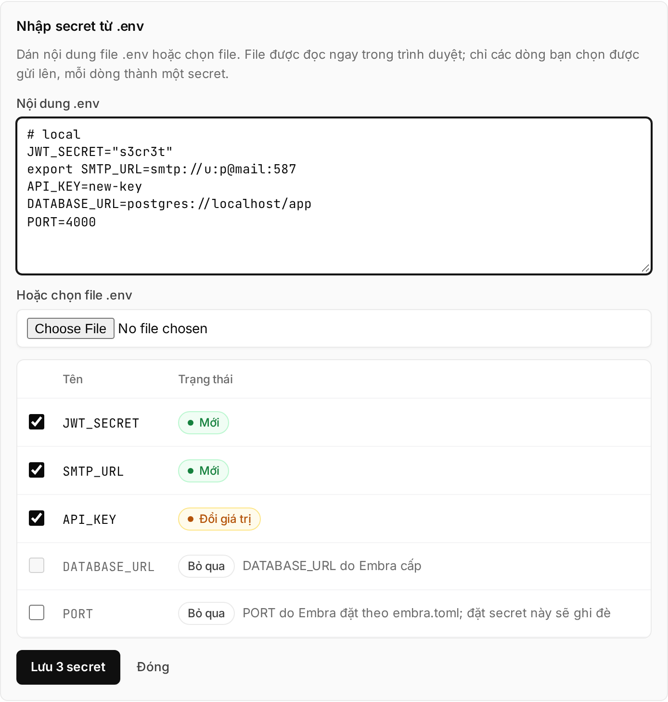

## Where to set env vars

| Kind | Where | Does the app see it at runtime? |
|---|---|---|
| Runtime: API keys, `TZ`, URLs… (non-secret values too) | The environment's **Cài đặt → Secrets** (settings, secrets) | Yes, same name |
| Build-time: `VITE_*`, `NEXT_PUBLIC_*`… | `[build] env` in `embra.toml` | No |
| `DATABASE_URL`, `PORT`, `S3_*` | Set by Embra | Yes |

- `embra.toml` has **no** `[deploy] env`. Unknown fields in `embra.toml` fail the build ([`REPO_CONFIG_INVALID`](/en/loi/#repo_config_invalid)).
- Adding, changing and revoking a single secret: see [Secrets](/en/huong-dan/secret/).

## Pasting a whole .env file

1. Open the environment's **Cài đặt → Secrets** → **"Dán .env"** (paste .env).
2. Paste into **Nội dung .env** (.env contents), or pick a file under **"Hoặc chọn file .env"** (or choose a .env file).
3. Check the table: each line is **Mới** (new), **Đổi giá trị** (replace value), **Giữ nguyên** (keep current) or **Bỏ qua** (skipped). Untick lines you don't want.
4. Click **"Lưu … secret"** (save … secrets).
5. Click **"Build lại"** (rebuild), if shown, so the app picks up the new values.



The file is read in your browser; only the lines you keep are sent to the server.

<details>
<summary>How the console reads a .env file</summary>

- Understands `#` comments, an `export ` prefix, single- or double-quoted values, multi-line values inside quotes.
- Does not expand `${OTHER_VAR}`: stored as written.
- A name that appears twice uses the later line.
- Skipped: empty values, invalid names, `DATABASE_URL`, names starting with `EMBRA_`, and `S3_*` when the environment has an Embra bucket.
- A `PORT` line starts unticked, because Embra already sets `PORT` from `embra.toml`.

</details>

## "Còn thiếu … biến" (… variables missing)

If the repo has a `.env.example` (or `.env.sample`), Embra reads the variable **names** in it on every build. Names with no secret yet show under **"Còn thiếu … biến"** on the Secrets page → click **"Thêm"** (add) next to a name.

<details>
<summary>Details</summary>

- Looked up in the app's root directory; if missing, in first-level subfolders (for example `backend/.env.example`).
- Only names are read, never values. A real `.env` file is never read.
- The list comes from the most recent successful build and leaves out variables Embra sets.
- A file over 64 KiB is ignored. At most 200 names.

</details>

## Variables Embra sets

| Variable | When | Value |
|---|---|---|
| `PORT` | Always, unless you set a `PORT` secret yourself | `[deploy] port` in `embra.toml`, default `3000` |
| `DATABASE_URL` | With `database = true` | The environment's Postgres connection string. See [Database](/en/huong-dan/database/) |
| `S3_ENDPOINT`, `S3_PUBLIC_ENDPOINT`, `S3_BUCKET`, `S3_REGION`, `S3_ACCESS_KEY_ID`, `S3_SECRET_ACCESS_KEY`, `S3_FORCE_PATH_STYLE` | The environment has an Embra bucket | See [File storage](/en/huong-dan/luu-file/) |
| `EMBRA_GIT_SHA` | Builds from a GitHub commit | The full 40-character commit SHA. Not set for builds from an uploaded folder (`embra up`) |

Embra does **not** set `TZ`: containers run on UTC. For Vietnam time, set a secret `TZ` = `Asia/Ho_Chi_Minh`.

On a name clash: a secret overrides an older plain variable; Embra's `DATABASE_URL` and `S3_*` override secrets. `PORT` is the exception: your secret wins.

:::caution[A `PORT` secret that differs from `[deploy] port` breaks the deploy]
Embra health-checks the app on the port in `[deploy] port`. If a `PORT` secret makes the app listen elsewhere, the health check fails and the deploy stops with [`HEALTHCHECK_FAILED`](/en/loi/#healthcheck_failed). To change the port, edit `[deploy] port`.
:::

## Names reserved for Embra

- A secret can't be named `DATABASE_URL` or start with `EMBRA_`. The console says `… dành cho Embra. Chọn tên khác.` (reserved for Embra, choose another name).
- `[build] env` does not accept names starting with `EMBRA_`.
- Names use uppercase letters, digits and `_`, start with an uppercase letter, at most 64 characters (`^[A-Z][A-Z0-9_]{0,63}$`).

## Build-time variables

```toml
[build]
env = { VITE_API_URL = "https://api.cuahang.vn", NEXT_PUBLIC_SHOP = "Cửa hàng" }
```

- Only exist during the build, never in the running app. **Don't put secret values here**: the file lives in your repo.
- Builds receive **no** secrets.
- With a `Dockerfile`, each variable is passed as a build arg; declare `ARG` before using it:

  ```dockerfile
  ARG VITE_API_URL
  RUN npm run build
  ```

- Without a `Dockerfile` (Railpack), the variables are available during the build with no declaration.

## One set of variables per environment

- Secrets on production are **not** on staging or previews, and the other way round. Set them per environment.
- Pull request previews don't carry production secrets.
- `[build] env` is the same everywhere because it lives in the repo.

See [Staging, production and approval](/en/huong-dan/staging-production-va-duyet/).

## When the app picks up new values

- Saving a secret does **not** restart the app. New values arrive on the **next build + deploy**: push code, or click **"Deploy"** / **"Build lại"** (rebuild) on the overview page.
- The plan shows the approver **Thêm secret**, **Bỏ secret**, **Đổi secret** (added, removed, changed secrets), never the values.
- Production still waits for an Owner or Admin to approve, as with every deploy.

## Limits

| Limit | Value | When exceeded |
|---|---|---|
| Each secret value | 64 KiB | Not saved: `Giá trị secret tối đa 64 KiB.` |
| Each "Dán .env" save | 100 secrets, 1 MiB total | Save button disabled. Untick some, save the rest later |
| File picked in "Dán .env" | 2 MiB | The console doesn't read it |
| Each `[build] env` value | 4 KiB | Build fails, the message names the variable. See [`REPO_CONFIG_INVALID`](/en/loi/#repo_config_invalid) |
| Total `[build] env` (names + values) | 16 KiB | Build fails |

Saving several secrets at once is all-or-nothing: if one line is rejected, none are saved.

## From the CLI

- `embra secret set <TEN>`: reads the value from stdin. `embra secret list`: names only.
- `embra deploy` (prebuilt image) reads the `env` field of `embra.json`: at most 4 KiB per value, 64 KiB total. These are kept on later builds from GitHub; a secret with the same name wins.

CLI sign-in for customers is **not switched on yet**; use the console for now. See [CLI commands](/en/cli/lenh/).

## See also

- [Secrets](/en/huong-dan/secret/)
- [Preparing your app](/en/huong-dan/chuan-bi-app/)
- [File storage (S3 bucket)](/en/huong-dan/luu-file/)
- [Staging, production and approval](/en/huong-dan/staging-production-va-duyet/)
