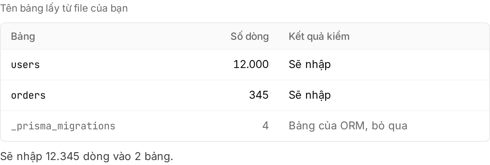

Order: adapt the app → deploy the schema → import the data → point the domain. When you're done, the app runs on Embra with its own Postgres holding your existing data, and your domain points to Embra.

## Check what needs to change

| Item | Why | How |
|---|---|---|
| Port and address | If the app listens only on `127.0.0.1`, Embra cannot reach it | Listen on `0.0.0.0` on the port in `PORT` (3000 by default). [Prepare your app](/en/huong-dan/chuan-bi-app/) |
| Health check | A new release only gets traffic after 3 `GET` requests in a row return 2xx | Set `[deploy] health_path` to a path that returns 2xx, not a redirect. [Health check](/en/huong-dan/chuan-bi-app/#health-check) |
| Writing files | The filesystem is read-only; only `/tmp` is writable and it is lost on restart | Store user uploads in an S3 bucket. [File storage](/en/huong-dan/luu-file/) |
| Database schema | The app's database user cannot change the schema | Put the schema in `migrations/NNNN_ten.sql` and drop the migrate command at startup. [Database and migrations](/en/huong-dan/database-va-migration/) |
| Extensions, functions, triggers, views | Migrations containing these are refused | An app that depends on them cannot move as it is yet |
| Env vars | The app reads each secret from an env var of the same name | Paste your `.env` file into Secrets (see below). [Secrets](/en/huong-dan/secret/) |
| Start command, workers, cron | Embra reads them from `embra.toml` | `[deploy] start`, `[processes.<name>]`, `[cron.<name>]` (UTC). [Prepare your app](/en/huong-dan/chuan-bi-app/#embratoml) |

## Differences per old host

| Old host | Watch out for |
|---|---|
| Vercel | `NEXT_PUBLIC_*` is embedded at build time: set it in `[build] env`, with no secret values. Vercel Postgres is now Neon: dump using the direct connection string, not the pooler |
| Railway, Render, Heroku | These also set `PORT`, so the app usually runs as is. The start command and background processes become `[deploy] start` and `[processes.<name>]` |
| VPS | Check whether the app writes logs, uploads or cache to disk: move those to `/tmp` or a bucket. A start command in pm2, systemd or Docker Compose becomes `[deploy] start` |

Backups downloaded from your old provider are usually not in the format Embra accepts. Create the file with `pg_dump` in the import step.

## Put the app and schema on Embra

1. Add `database = true` under `[deploy]` in `embra.toml`, plus a `migrations/` folder that creates every table of the old database. Using Prisma? Follow the [Prisma section](/en/huong-dan/database-va-migration/#writing-migrations).
2. Create the app as in [Deploy from GitHub](/en/huong-dan/deploy-tu-github/). Embra creates the `production` environment and runs a first build, without secrets.
3. Open **Cài đặt → Secrets** (settings, secrets) → **"Dán .env"** (paste .env), paste your old app's `.env` → **"Lưu … secret"** (save … secrets). Embra skips `DATABASE_URL` and `EMBRA_*` names.
4. Click **"Deploy"** (or **"Build lại"**, rebuild) on the overview page to build again with the secrets. The first build's plan is cancelled; no need to approve it.
5. Approve the new plan. The migrations create empty tables in Embra's Postgres.
6. Open the environment's `….onembra.com` address and check the app runs against the empty database.

With a staging environment or a PR preview, try everything there first (including the import), then do production.

## Import your Postgres data

Embra imports only **data rows** into tables that already exist and are **empty**. The schema always goes through migrations.

:::caution[Import before production gets traffic]
If even one target table has data (for example one test sign-up), the import is refused. Data written to the old app after the dump cannot be added later into tables that already have data either.
:::

1. For the real production import, stop writes on the old app first (maintenance page or read-only mode). Data written after the dump starts is not in the file.
2. Run this on a machine that can read the old database, replacing `<DATABASE_URL>` with its connection string:

   ```sh
   pg_dump --data-only --no-owner --no-acl -d "<DATABASE_URL>" | gzip > data.sql.gz
   ```

   If a table already has data on Embra (for example a table a migration seeded), leave its data out of the file:

   ```sh
   pg_dump --data-only --no-owner --no-acl --exclude-table-data=public.admin_users -d "<DATABASE_URL>" | gzip > data.sql.gz
   ```

3. In the console: **Tổng quan** (overview) → **Những gì đang chạy** (what's running) → click the **Database** row → **"Nhập dữ liệu…"** (import data).
4. Pick the file under **"File dump (.sql hoặc .sql.gz)"** (dump file) → **"Tải lên và kiểm"** (upload and check). Embra shows the number of rows and tables in the file.
5. Click **"Kiểm với database"** (check against the database). Embra compares the file with the database without writing anything. You're good when every table shows **"Sẽ nhập"** (will import) or **"Bảng của ORM, bỏ qua"** (ORM table, skipped).

   

6. Staging and previews: Embra imports right away. Production needs an Owner or Admin to approve within 1 hour; after that the import is cancelled and the file must be uploaded again:
   - Owner, Admin: type the environment name and click **"Duyệt và nhập dữ liệu"** (approve and import) right in the dialog.
   - Developer: click **"Mở trang duyệt"** (open approval page) and send that page to an Owner or Admin.
7. Wait for **"Đã nhập … dòng vào … bảng."** (imported … rows into … tables), then open the app and check a few records you know (an order number, a total), not just row counts.

The whole import runs in one transaction: if anything fails, the database is left unchanged. Deploys of the environment wait while the import runs.

| File requirement | Detail |
|---|---|
| Format | `--data-only` is required, plain SQL (gzip allowed). Files with `CREATE` or `ALTER`, files made with `--inserts` and the custom format (`-Fc`) are refused |
| Schema, encoding | Only tables in the `public` schema, UTF8 |
| Size | Also after decompression, no larger than your plan's database storage. An uploaded file that is not used is deleted after 24 hours |
| ORM migration tables | `_prisma_migrations`, `knex_migrations`, `schema_migrations`, `django_migrations`… are skipped when Embra's database doesn't have them |
| Who sees **"Nhập dữ liệu…"** | Owners, Admins, Developers |

## Fix a failed check

| Embra says | Fix |
|---|---|
| **"Database không có bảng này"** (no such table), **"Thiếu cột: …"** (missing columns), **"Database không có sequence …"** (no such sequence) | Add the table or column with a migration and deploy, or leave that table's data out with `--exclude-table-data`. Create a new file and upload again |
| **"Bảng đã có dữ liệu"** (table already has data) | If you already imported this file, the data is in. If not, leave that table's data out with `--exclude-table-data` and upload again |
| The file is refused right after upload | Run `pg_dump` again with exactly the command above, including `--data-only`. If the old database is not UTF8, add `--encoding=UTF8` |

Embra only imports Postgres dumps; MySQL and other databases cannot be imported yet. Any other error: email hello@embra.cloud with the import's `operation_id`, your workspace, the environment and the time.

## Point your domain to Embra

1. Lower the TTL of your domain's records at your DNS provider to about 300 seconds, 1–2 days ahead.
2. Open the production environment's **Cài đặt → Domain** (settings, domain), enter the domain → **"Thêm domain"** (add domain).
3. Add the TXT record Embra shows. It does not affect the old app.
4. Once the data is imported, change the CNAME record (or A for the bare domain) to the value Embra shows.
5. Click **"Kiểm tra"** (check). Embra needs both the TXT and the CNAME (or A) right before it verifies; HTTPS is issued on the first request.
6. Keep the old app and database read-only for a few days, in case you find missing data.

An unverified domain is kept only 7 days, so don't add it too early. Details and the Cloudflare note: [Custom domains](/en/huong-dan/domain-rieng/).

## See also

- [Prepare your app](/en/huong-dan/chuan-bi-app/)
- [Database and migrations](/en/huong-dan/database-va-migration/)
- [Secrets](/en/huong-dan/secret/)
- [File storage (S3 bucket)](/en/huong-dan/luu-file/)
- [Custom domains](/en/huong-dan/domain-rieng/)
- [Error codes](/en/loi/)
