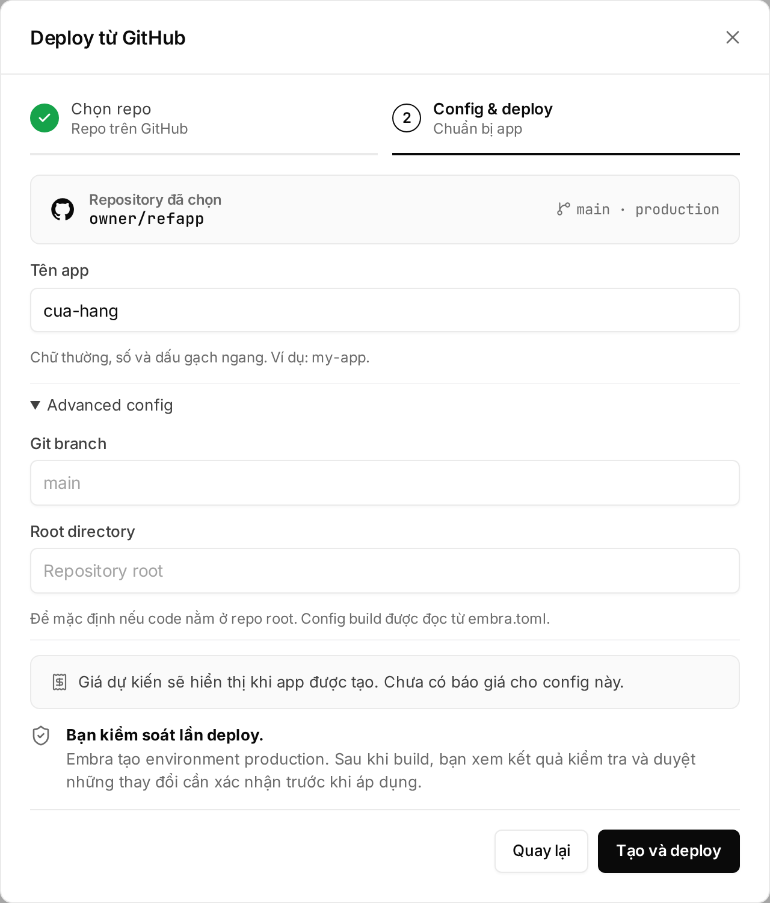
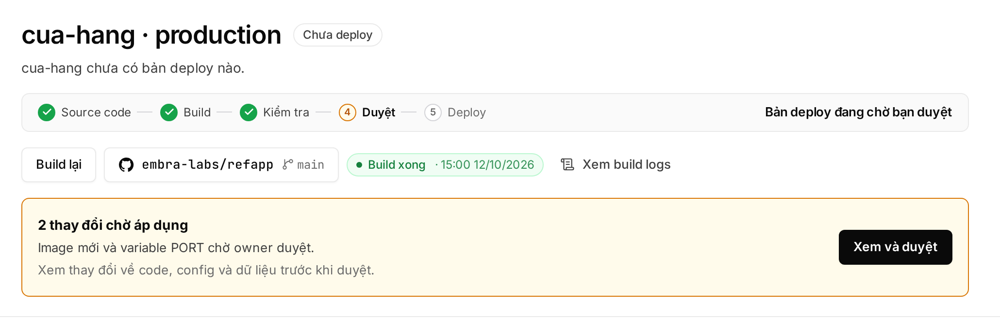

## Creating the app

1. Click **"＋ Tạo mới"** (create) → **"Deploy từ GitHub"**.
2. Click **"Kết nối GitHub ↗"** (connect GitHub) and install the Embra GitHub App on the account or organization that owns the repo. You choose which repos Embra can see.
3. Pick the repo → **"Tiếp tục"** (continue).
4. Set **Tên app** (app name): lowercase letters, digits and `-`, starting with a letter. For a monorepo or a non-default branch, open **"Advanced config"** and set **Git branch** and **Root directory**.
5. Click **"Tạo và deploy"** (create and deploy). Embra creates the `production` environment, links repo + branch and builds.



Repo missing? Click **"Không thấy repo? Cập nhật quyền GitHub ↗"** (update GitHub permissions), then **"Tải lại"** (reload). Only people signed in with GitHub can link a repo, and only repos their GitHub account can read.

## Approving production

After the build, Embra makes a **plan**: a summary of the change (new image, secrets added/removed/changed, pending migrations).



1. The plan bar shows "… thay đổi chờ áp dụng" (changes waiting) → click **"Xem và duyệt"** (review and approve).
2. Check the code, config and data changes.
3. Type the environment name → **"Duyệt và deploy"** (approve and deploy). If a migration may lose data, also type `CONFIRM_MIGRATION`.

| Rule | Detail |
|---|---|
| Who can approve | Owner and Admin only. Production always waits for approval, even with no migration. Developers and AI agents cannot approve |
| Real person | A web session signed in within the last 12 hours. See [Actions that need a real person](/en/workspace/phan-quyen/#actions-that-need-a-real-person) |
| Expiry | A pending plan expires after 24 hours |
| New build | Cancels the older plan, so you never approve a stale version by mistake |

Once approved, the app is at:

```
https://<app-name>-production-<workspace code>.onembra.com
```

## Building on push

- Push to the linked branch → Embra builds that commit. Other branches and new tags don't build.
- A new build cancels a running build of the same environment.
- To rebuild the latest commit without pushing, click **"Deploy"** on the overview page (it reads **"Build lại"**, rebuild, while a plan is waiting).
- Production waits for approval after each build. Staging and previews deploy on their own, unless a migration changes data.

## Pull request previews

On plans with previews (see [pricing](https://embra.cloud/bang-gia/)), each PR into the production branch gets its own `pr<number>` environment.

| Item | Preview |
|---|---|
| URL | `pr<number>-<production address>` |
| Database | New and empty, no production data copied. Load sample data with `[preview] seed` |
| Secrets, bucket, domains | Not carried over from production |
| Auto delete | When the PR closes, or after 72 hours without a new push |
| PRs from forks | Ignored |

## Logs

- **Build log:** **"Xem build logs"** (view build logs) on the overview page. Look up error codes in [Error codes and fixes](/en/loi/).
- **App log:** the **"Logs"** section. Containers run on UTC; for Vietnam time set the secret `TZ` = `Asia/Ho_Chi_Minh`.
- Log and metrics retention depends on the plan (trial: 1 day).

## Rollback

Click **Quay về bản trước** (roll back) on the **Lịch sử & khôi phục** (history & restore) rail of the environment page. The web always goes back exactly one version.

- No approval needed, because a rollback only reruns code that was already approved.
- Embra refuses if a migration has moved on since that version.

Details: [Rollback and restoring backups](/en/huong-dan/rollback-va-khoi-phuc/). Urgent help: hello@embra.cloud.
