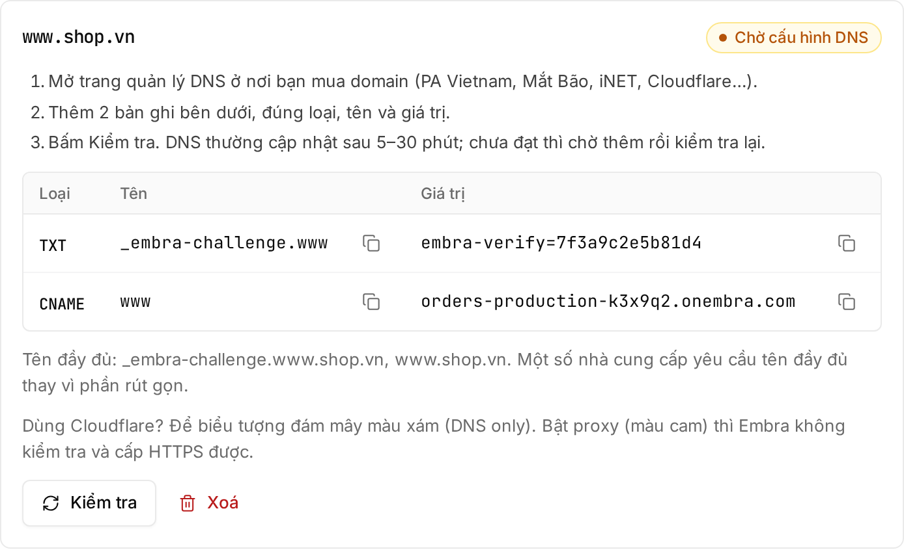

| Plan | Domains |
|---|---|
| Trial | None |
| Start | 3 |
| Build | 5 |
| Grow | 10 |

Counted across all environments of the workspace. **Each name counts as one domain**: `shop.vn` and `www.shop.vn` are two domains.

## Steps

1. Open **Cài đặt → Domain** (settings, domain), enter the domain (for example `www.shop.vn` or `shop.vn`) → **"Thêm domain"** (add domain).
2. Add the records Embra shows at your DNS provider:

   | Type | Name | Value |
   |---|---|---|
   | TXT | `_embra-challenge.www.shop.vn` | `embra-verify=…` (Embra shows the value) |
   | CNAME | `www` | the app address, like `<app>-production-<code>.onembra.com` |

   **Root domain** (`shop.vn`, no `www`): use an **A** record to the IP Embra shows instead of the CNAME.

   
3. Wait for DNS to update (usually 5–30 minutes) → click **"Kiểm tra"** (check). If it doesn't pass yet, wait and check again.
4. Once verified, HTTPS is issued automatically on the first request, usually within a minute.

:::caution[Using Cloudflare?]
Keep the cloud icon **grey (DNS only)** for these records. With the proxy on (orange cloud), Embra can neither verify the domain nor issue HTTPS.
:::

## Keep the TXT record

**Don't delete the TXT record after verification.** Embra re-checks it every 24 hours. If it is missing 3 times in a row, Embra stops serving that domain. Temporary network errors don't count.

## Notes

- For both `shop.vn` and `www.shop.vn`, add both. Embra doesn't redirect between the two names yet; set a redirect at your domain provider.
- Wildcard domains (`*.shop.vn`) and uploading your own certificate are not supported yet.
- A domain can only be attached to one app on Embra.
- A domain that is never verified is dropped after 7 days.
- Each domain can be checked at most once every 30 seconds.
