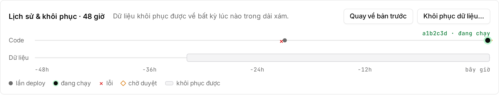
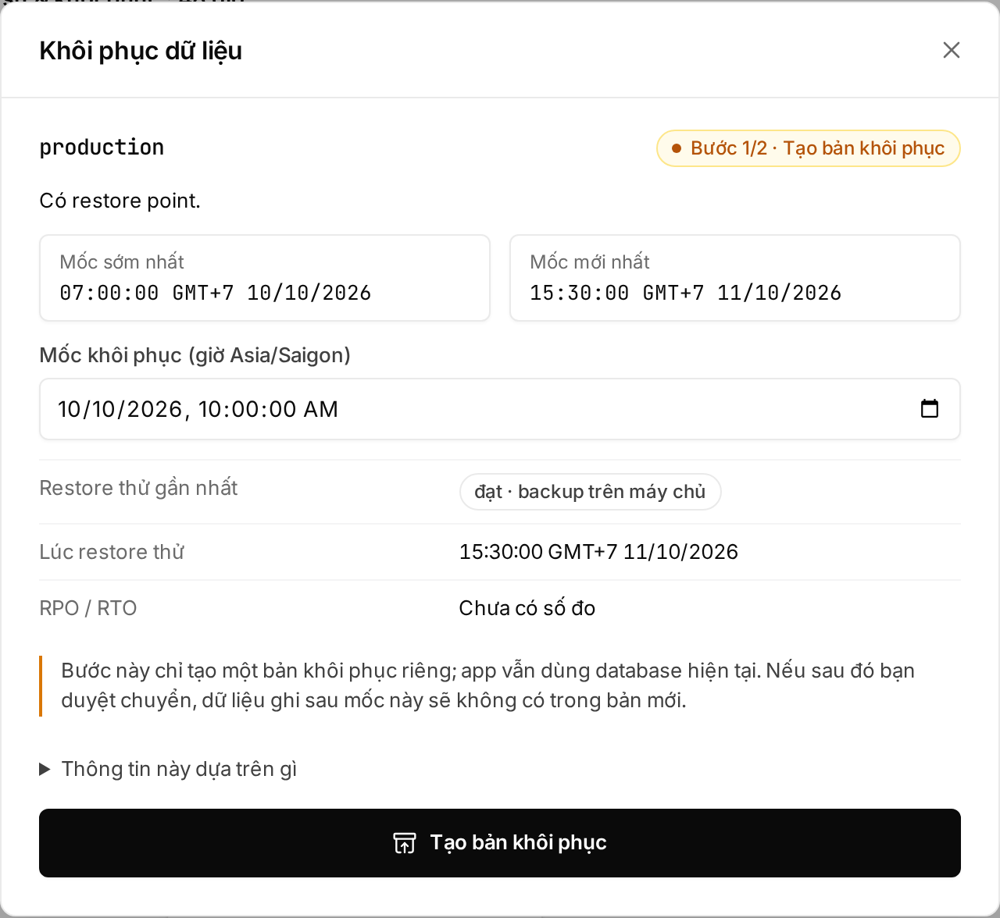

## Which one do you need?

| You have | Use | Touches data? | Needs approval? |
|---|---|---|---|
| A broken release, data is fine | Rollback | No | No |
| One bad `UPDATE`, and data written after it must stay | [Row-level undo](/en/huong-dan/undo-tung-dong/) | Only the wrongly changed rows, through the migration gate | Owner or Admin |
| Data deleted or written wrong at large | Restore a backup | Yes: data written after the chosen point is lost | Owner or Admin |
| Moving the app + data elsewhere | Export | No | Only Owner or Admin can create one |

## Rolling back to the previous version

A rollback reruns the deploy **right before** the running one: start, health check, traffic switch. Data in the database is not rewound.

- Owners, Admins and Developers can roll back.
- No approval needed, even in production, because that version was already approved and ran.

1. Open the environment and find the **"Lịch sử & khôi phục"** (history & restore) rail at the top.
2. Click **"Quay về bản trước"** (roll back). The button only shows after at least 2 successful deploys, and is locked while another operation runs.
3. Production: type the environment name, then click **"Quay về bản trước"** in the dialog.
4. Embra opens the operation page. The old version has traffic when the state reads **"Deploy thành công"** (deployed).



The web only goes back exactly one version. To go further back, use the CLI:

```sh
embra rollback --env <project>/<env> --to <release_id>
```

- `release_id` (`rel_…`): the running one is on the `release đang chạy:` line of `embra status --env <project>/<env>`; older ones are in `data.release_id` of `deploy.healthy` events in `embra events --env <project>/<env> --json`.
- Only a release that **has run** in this environment and was replaced (`retired`). The same checks as a normal rollback apply: migrations run after it, revoked secrets.

### Rolling back a second time

A rollback creates a new release, and its "previous version" is the broken one you just left. Clicking **"Quay về bản trước"** again **brings the broken version back**; it doesn't go further. To fix forward, push a new commit.

### When Embra refuses a rollback

Embra checks before doing anything, so a refusal leaves the running app untouched.

| Reason | Error code | What to do |
|---|---|---|
| A migration ran after that version | [`ROLLBACK_INCOMPATIBLE`](/en/loi/#rollback_incompatible) | Fix with a new commit that works with the current schema |
| A secret that version used was revoked | [`SECRET_REVOKED`](/en/loi/#secret_revoked) | Deploy a new version with the current secrets |
| Another operation has not finished | [`OPERATION_IN_PROGRESS`](/en/loi/#operation_in_progress) | Wait for it to finish |
| The environment is blocked after an incident | [`ENVIRONMENT_BLOCKED`](/en/loi/#environment_blocked) | Contact the Embra team |
| The running version is the first one, or the environment is paused | [`INVALID_INPUT`](/en/loi/#invalid_input) | Nothing to go back to / resume the environment first |

A rollback restores code, not the schema. Old code may not run on the new schema, so Embra blocks it once migrations have moved on.

## Database backups

Every environment with Postgres is backed up automatically; nothing to turn on.

| Item | Detail |
|---|---|
| Continuous | Every change is recorded (WAL) and pushed to the backup at least once a minute |
| Full backups | Every 7 days; the 2 most recent are kept |
| Restorable range | From the oldest full backup kept up to about 1–2 minutes ago. New database: starts at the first full backup. Database older than 2 weeks: 7 to 14 days long, depending on when the latest full backup ran |
| Where | On the server, on a separate disk from the database. No off-server copies yet |
| Restore tests | Every 7 days Embra rebuilds the database from the backup to make sure it works. The result shows under **Backup** in the status band at the top of the environment page |

| Console shows | Meaning |
|---|---|
| **"Restore thử đạt"** (restore test passed) | The latest restore test succeeded |
| **"Chưa restore thử"** (not restore-tested) | New database, first restore test not run yet |
| **"Restore thử thiếu dữ liệu"** (restore test came up short) | The backup is missing a stretch ([`BACKUP_WAL_GAP`](/en/loi/#backup_wal_gap)) |
| **"Restore thử thất bại"** (restore test failed) | The backup could not be rebuilt. Don't rely on the restore range; email hello@embra.cloud |

Backups pause while the database is stopped or the environment is blocked after an incident.

## Restoring the database to a point in time

A restore has two steps: look first, then switch the app.

```
Bước 1: Tạo bản khôi phục        Bước 2: Chuyển sang bản này
(Owner, Admin, Developer)        (Owner hoặc Admin, trong 2 giờ)
database mới chạy song song  →   app dùng database mới
app vẫn dùng database cũ         database cũ giữ 72 giờ, chỉ đọc
```

(Step 1: create a restored copy, a new database running alongside while the app keeps the old one. Step 2: switch to it, approved by an Owner or Admin within 2 hours; the old database is kept read-only for 72 hours.)

**Step 1. Create the restored copy**

1. On the **"Lịch sử & khôi phục"** rail, click **"Khôi phục dữ liệu…"** (restore data), or **"Xem mốc khôi phục"** (view restore points) on the overview page.
2. Check the restorable range, from **"Mốc sớm nhất"** (earliest) to **"Mốc mới nhất"** (latest).
3. Enter a **Mốc khôi phục** (restore point) in that range, in your device's time zone.
4. Click **"Tạo bản khôi phục"** (create restored copy). Embra builds a new database from that point; the running database is not touched.



**Step 2. Switch to the restored copy** (Owner or Admin)

1. When the copy is ready, the operation page shows **"Chuyển sang bản khôi phục"** (switch to the restored copy) with an estimated row count per table.
2. Type the environment name to confirm.
3. Click **"Chuyển sang bản này"** (switch to this copy), or **"Huỷ bản khôi phục"** (cancel this restore) to drop it.
4. Embra moves the app to the new database without stopping it.

The approver must have signed in on the web within 12 hours. If nobody approves within 2 hours, the copy is cancelled and cleaned up; start again from step 1.

:::caution[Data written after the chosen point is lost]
After the switch, anything the app wrote after the restore point is not in the new database. During the switch the old database becomes read-only, so the app may report write errors for a few seconds.
:::

### Going back to the old database after a restore

The old database is kept for **72 hours** after the switch (trial: 24 hours). During that time, rolling back to the deploy that ran before the restore moves the app back to the old database.

- Owner or Admin only, and a real person (a web session within 12 hours).
- After the retention period the old database is deleted: the rollback fails with [`ROLLBACK_DB_GONE`](/en/loi/#rollback_db_gone).
- If a migration ran on the new database after the switch, the rollback is blocked with [`ROLLBACK_INCOMPATIBLE`](/en/loi/#rollback_incompatible).

:::danger[Writes to the new database are lost]
Going back to the old database discards everything the app wrote to the new database since the switch. There is no way to get that back.
:::

### When a restore does not work

| You see | Error code | What to do |
|---|---|---|
| The point is outside the range, or there is no backup yet | [`RESTORE_POINT_UNAVAILABLE`](/en/loi/#restore_point_unavailable) | Pick a point between **"Mốc sớm nhất"** and **"Mốc mới nhất"** |
| A migration ran after the chosen point | [`MIGRATION_AFTER_RESTORE_POINT`](/en/loi/#migration_after_restore_point) | Pick a point after that migration |
| The backup cannot reach that exact point | [`RESTORE_SHORT`](/en/loi/#restore_short) | Email hello@embra.cloud |
| The operation shows **"Cần đội Embra hỗ trợ"** (needs the Embra team) | [`RECOVERY_REQUIRED`](/en/loi/#recovery_required) | Don't delete the environment; email with the operation ID |

You can't restore while the environment is paused or the database is stopped; start it first.

## Exporting data

An export builds a bundle with the image, manifest, a `pg_dump` and the list of bucket objects. The bundle contains no secret values.

1. Open **"Cài đặt"** (settings) → **"Dữ liệu"** (data) → **"Export"**.
2. To include the files in the bucket, tick **"Kèm nội dung object của bucket"** (include bucket object contents).
3. Click **"Tạo export"** (create export).
4. When it finishes, click **"Tải bundle"** (download bundle).

| Item | Detail |
|---|---|
| Who | Owner or Admin only. Exporting production needs a web session signed in within 12 hours |
| Auto delete | After 24 hours |
| Over the size limit | [`QUOTA_EXCEEDED`](/en/loi/#quota_exceeded) |

## Using the CLI

The matching commands ([install the CLI](/en/cli/cai-dat/)):

```sh
embra rollback --env <project>/<env> [--to <release_id>]
embra db restore-points --env <project>/<env>
embra db restore --env <project>/<env> --to 2026-11-01T08:30:00+07:00
embra export --env <project>/<env>
```

`embra db restore` only creates the restored copy. The switch still needs an Owner or Admin to approve.

## See also

- [Row-level undo](/en/huong-dan/undo-tung-dong/)
- [Incident runbook](/en/huong-dan/runbook-su-co/)
- [Database and migrations](/en/huong-dan/database-va-migration/)
- [Logs and monitoring](/en/huong-dan/log-va-theo-doi/)
- [Rollback and restore: error codes](/en/loi/#rollback-and-restore)
- [Members and permissions](/en/workspace/phan-quyen/)
