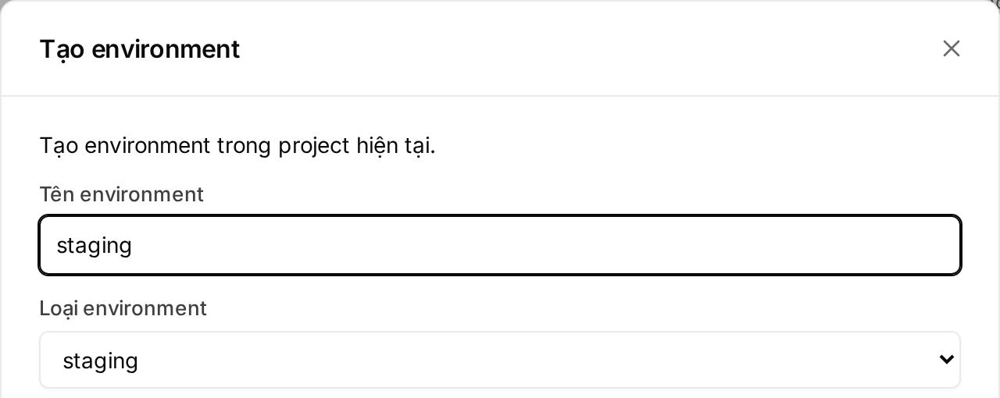

## What an environment is

Each project has one or more **environments**: each is a separate running copy of the app with its own Postgres, secrets, bucket and URL. Secrets on production are **not** on staging, and the other way round.

| Kind | How it is created | Deploys |
|---|---|---|
| `production` | Created with the app when you deploy from GitHub | **Always wait for an Owner or Admin to approve** |
| `staging` | Created by hand, at most one (see below) | Go out on their own, unless a migration changes or deletes data |
| Preview `pr<number>` | Created per pull request, on plans with previews | Like staging. See [Pull request previews](/en/huong-dan/deploy-tu-github/#pull-request-previews) |

Default URL of each environment:

```
https://<tên-project>-<tên-environment>-<6 ký tự cuối mã workspace>.onembra.com
```

That is `<project-name>-<environment-name>-<last 6 characters of the workspace id>`.

## How staging differs from production

| | Production | Staging |
|---|---|---|
| Approval | Every plan, even without migrations | Only when a migration changes or deletes data |
| Postgres | Its own | Its own, production data is **not** copied |
| Secrets, bucket, domains | Its own | Its own, set them again for staging |
| RAM, CPU | The app size in the plan's resource pool | Half of the plan's RAM, CPU and IOPS (at least 256 MiB RAM, 0.25 vCPU), outside the pool |
| Disk | Per plan | Same as production |
| Price | Included in the plan | The Start plan has no staging. Other plans charge a monthly add-on, see the [pricing page](https://embra.cloud/bang-gia/) |

## Creating staging

Only the **Owner** can create staging when it is billed, and it must be a real person who signed in recently.

1. Open the project → **"Tạo mới"** (create) → **"Environment mới"** (new environment).
2. Enter **Tên environment** (environment name), for example `staging` (lowercase letters, digits, `-`).
3. Under **Loại environment** (environment type), pick `staging` → **"Xác nhận tạo environment"** (confirm).

   

4. Open the new environment's **Cài đặt → Source code** (settings, source code) and pick the **Repository**. Under **"Advanced config"**, enter a **Branch** (for example `develop`) → **"Kết nối repo"** (connect repo).
5. Open **Cài đặt → Secrets** and set the secrets for staging. See [Secrets](/en/huong-dan/secret/).

From then on, every push to that branch builds and deploys staging.

| If you see | Do this |
|---|---|
| `Gói … không có staging. …` or `Mỗi project có tối đa một staging. …` | Upgrade, or delete the old staging. The limit counts across the whole workspace. See [`QUOTA_EXCEEDED`](/en/loi/#quota_exceeded) |
| `Workspace đang trong kỳ trả trước tới …` | Staging can't be added in the console during a prepaid term. Email hello@embra.cloud and the Embra team adds it for you |

## What a deploy plan is

When a build finishes, Embra makes a **plan**: a summary of everything that will change on deploy. The approver reviews exactly this plan.

```
push → build → plan → (diễn tập migration) → chờ duyệt? → deploy
```

(push, build, plan, migration rehearsal, wait for approval?, deploy)

| Part of the plan | Contents |
|---|---|
| **Code mới (image)** (new code) | The old and the new image |
| **Secret** | Added, removed or re-versioned. Values are never shown |
| **Environment variables** | Added, removed or changed. See [Environment variables](/en/huong-dan/bien-moi-truong/) |
| **Migration** | Files waiting to run, the rehearsal result on a copy of the data, schema changes and **Dữ liệu có thể mất** (data that may be lost) |

A plan with migrations is first **rehearsed on a copy of the data**. If the rehearsal fails, the plan stops with [`MIGRATION_REHEARSAL_FAILED`](/en/loi/#migration_rehearsal_failed) and the real database is untouched.

## When a deploy waits for approval

| Case | Production | Staging, preview |
|---|---|---|
| No migrations | Waits | Goes out |
| Safe migrations, long table locks, or statements outside a transaction | Waits | Goes out |
| Migration changes or deletes data | Waits | Waits |
| Rehearsal estimates rows will be lost | Waits, and you also type `CONFIRM_MIGRATION` | Waits, and you also type `CONFIRM_MIGRATION` |
| Unsupported migration | Refused, see [`MIGRATION_UNSUPPORTED`](/en/loi/#migration_unsupported) | Refused |

- Which migration falls in which group: see [How Embra checks migrations](/en/huong-dan/database-va-migration/#how-embra-checks-migrations).
- A plan waiting for approval has the code [`APPROVAL_REQUIRED`](/en/loi/#approval_required), or [`MIGRATION_DATA_LOSS`](/en/loi/#migration_data_loss) when the rehearsal shows data will be lost.

## Who can approve

- **Only Owners and Admins.** Developers, Viewers and AI agents can't approve, but Developers and agents can still **create** plans.
- Needs a **real person**: a web session signed in within the last 12 hours. After 12 hours, sign in again ([`REAUTH_REQUIRED`](/en/loi/#reauth_required)).
- Machine tokens (CI, agent) can never approve ([`HUMAN_REQUIRED`](/en/loi/#human_required)).

Details: [Members and permissions](/en/workspace/phan-quyen/).

## Approving in the console

1. Open the environment's **Tổng quan** (overview). The plan bar shows **"… thay đổi chờ áp dụng"** (changes waiting), or the **"Chờ bạn duyệt"** (waiting for your approval) section → click **"Xem và duyệt"** (review and approve).
2. Read **Tác động** (impact: code, secrets, environment variables) and **Migration** (rehearsal result, **Thay đổi schema** (schema changes), **Dữ liệu có thể mất** (data that may be lost)).
3. Check **Hạn duyệt** (approval deadline) under **Quyết định của bạn** (your decision).
4. Production only: type the environment name in the **"Gõ … để chắc là bạn đang duyệt đúng chỗ"** box (type the name to confirm you are in the right place).
5. Data-loss warning: type `CONFIRM_MIGRATION` in the **"Gõ CONFIRM_MIGRATION để xác nhận rủi ro dữ liệu"** box.
6. Click **"Duyệt và deploy"** (approve and deploy), or **"Từ chối"** (reject).

A Developer who opens this page can still read the plan, but the approval area only shows **"Chỉ owner hoặc admin thực hiện được"** (only an owner or admin can do this). Send the page link to an Owner or Admin.

:::caution[A migration that drops data can't be undone on its own]
Once you approve and the migration has run, you can't restore the database to a point before that migration. To keep the data, export it before approving. See [`MIGRATION_DATA_LOSS`](/en/loi/#migration_data_loss).
:::

## After approving, rejecting or expiry

| Outcome | What happens |
|---|---|
| **Approved** | The deploy is queued: migrations (if any), then the new version runs next to the old one until it passes the health check. See [Health check](/en/huong-dan/chuan-bi-app/#health-check) |
| **Rejected** | The plan is cancelled and nothing is applied. The running app keeps running. Fix the code and push again for a new plan |
| **Expired** | The plan is cancelled ([`APPROVAL_EXPIRED`](/en/loi/#approval_expired)). Click **"Build lại"** (rebuild) for a new plan |
| **A newer build** | Older plans created by a build are cancelled, so you never approve a stale version by mistake. Approve the new plan |
| **The environment changed while waiting** | The plan is cancelled ([`GENERATION_CONFLICT`](/en/loi/#generation_conflict)), for example after a rollback |

| Plan | Approval deadline |
|---|---|
| **Production plan** | Expires **24 hours** after it was made |
| **Plan with migrations** (staging included) | Depends on the rehearsal result, valid for **24 hours**. After that it can't be approved; rebuild to rehearse again |

Rolling back code needs no approval. See [Rollback](/en/huong-dan/deploy-tu-github/#rollback).

## See also

- [Deploy from GitHub](/en/huong-dan/deploy-tu-github/)
- [Database and migrations](/en/huong-dan/database-va-migration/)
- [Members and permissions](/en/workspace/phan-quyen/)
- [Error codes](/en/loi/)
