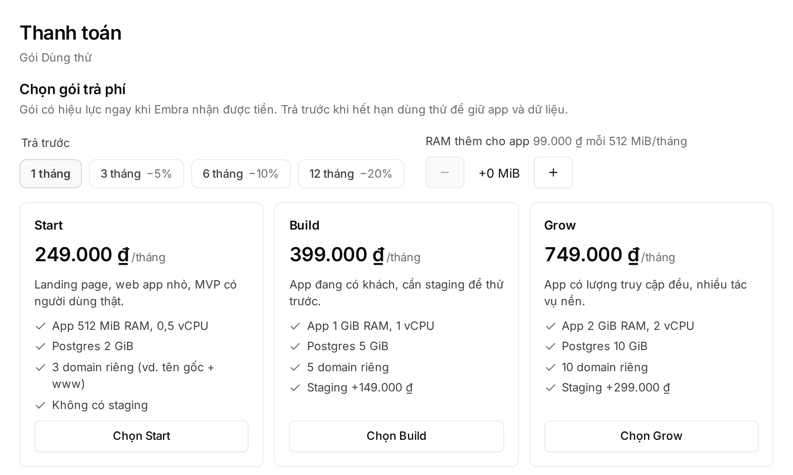

## Signing in

Open the console and click **"Đăng nhập bằng GitHub"** (sign in with GitHub). On your first sign-in, Embra creates a **trial workspace** named after your GitHub account, with you as Owner.

| Rule | Detail |
|---|---|
| GitHub account age | At least **30 days**. Newer account: email your GitHub username to hello@embra.cloud to have it let in individually |
| Trials | The number of new trials per day is limited |
| **"Đăng nhập bằng Google"** (sign in with Google) | Only for people invited to an existing workspace. Google sign-in never creates a workspace |
| GitHub email with a pending invite | You go straight into that workspace and do **not** get a trial |

Seeing **"Chưa vào được Embra"** (you can't sign in yet)? Three possible reasons:

- You signed in with a Google email nobody invited → ask an Owner to invite that exact email.
- Your GitHub account is younger than 30 days.
- Today's trials are used up → try again tomorrow.

For help, email hello@embra.cloud.

## The trial

| Item | Trial |
|---|---|
| Length | 7 days |
| App | 1 project, 1 environment (production) |
| Postgres | 1 |
| Custom domains, PR previews, cron | Not included |

The **"Dùng thử · xoá sau N ngày"** banner (trial, deleted in N days) shows the time remaining.

:::caution[After 7 days everything is deleted]
When the trial expires, every action is refused, including viewing. Then **the whole workspace is deleted**: app, database and backups. Without a chosen plan there is no grace period. If you chose a plan before the trial ended, Embra keeps the workspace **72 more hours** waiting for the transfer; the Owner still sees the transfer code and QR on the expired screen.

To keep your app, **choose a plan and pay before the trial ends**. Embra warns you 24 hours before. If you only want your data, export it under **Cài đặt → Dữ liệu → Export** (settings, data, export) before the deadline.
:::

## Choosing a plan and paying

Only the **Owner** can choose a plan, and only in the browser.

1. Click **"Chọn gói"** (choose a plan) on the trial banner, or open the account menu → **"Thanh toán"** (billing).
2. Under **"Trả trước"** (prepay), choose 1, 3, 6 or 12 months (0/5/10/20% off). Add **"RAM thêm cho app"** (extra app RAM) if needed.
3. Click **"Chọn Start"**, **"Chọn Build"** or **"Chọn Grow"**. Prices and limits: [embra.cloud/bang-gia](https://embra.cloud/bang-gia/).
4. Optionally enter the person or company name for the invoice. Embra is not yet a registered company, so it cannot issue VAT invoices.
5. Click **"Xác nhận và lấy mã VietQR"** (confirm and get the VietQR code).
6. Scan the code with your banking app, or transfer by hand with exactly the **amount** and **transfer note** shown (each has a **"Chép"** copy button).

- The plan takes effect as soon as Embra receives the money, and the workspace no longer has a trial deadline.
- If the payment is not confirmed automatically, the Embra team confirms it by hand during working hours.
- Invoice status is under **"Hoá đơn"** (invoices): unpaid, reconciling, paid or overdue.
- Admins can see billing but cannot choose a plan or pay. See [Members and permissions](/en/workspace/phan-quyen/).

## Changing plans after paying

Open **"Thanh toán"** (billing) and choose another plan. The console shows the amount or the change date before you confirm.

**Upgrade** (higher monthly price):

- Pay the daily-prorated difference from today to the end of the period (on a prepaid term: to the end of the term, at the term discount), rounded down to 1,000 ₫.
- **The plan changes only when the money arrives.** If your balance covers it, the plan changes at once.
- The payment code works until the end of the current period. Money arriving later goes to your balance and the plan stays; choose the plan again for a new amount.

**Downgrade** (lower monthly price):

- The current plan stays until the end of the period; the new one starts with the next period. Changed your mind? Click **"Giữ gói …"** (keep plan) before that day.
- The workspace must fit the new plan in custom domains, staging, previews, storage and number of databases. App sizes shrink automatically at the next deploy.

While an invoice is overdue, plans cannot be changed. Full rules: [Terms, section 4](https://embra.cloud/terms/#goi) (Vietnamese).
