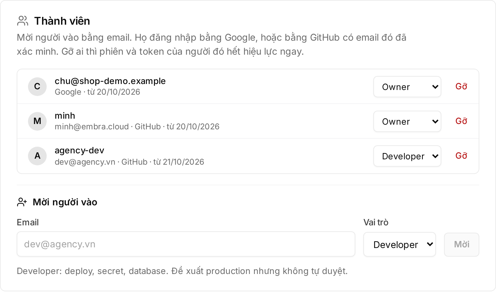

For who can invite whom and what each role can do, see [Members and permissions](/en/workspace/phan-quyen/).

## Inviting someone into the workspace

An Owner or Admin does this in the browser. The CLI can only list members (`embra members list`).

1. Open **Cài đặt** (Settings) → **"Thành viên"** (Members).
2. In **"Mời người vào"** (Invite someone), enter the **Email**.
3. Choose a **Vai trò** (Role): Admin, Developer or Chỉ xem (Viewer). An Admin can only invite Developer and Viewer.
4. Click **"Mời"** (Invite). The console says "Đã gửi lời mời. Lời mời còn hạn 14 ngày." (Invite sent. It is valid for 14 days.)

The invite shows in the list as **"Chờ đăng nhập · hết hạn …"** (Waiting to sign in · expires …). To cancel it, click **"Thu hồi"** (Revoke) on that row.

:::note[Embra does not email invites yet]
Embra sends no email for workspace invites. Tell the person yourself: open the console and sign in with the exact email that was invited.
:::

## What the invited person does

| Case | What to do |
|---|---|
| No Embra account yet | Click **"Đăng nhập bằng Google"** (Sign in with Google) with the invited email, or **"Đăng nhập bằng GitHub"** (Sign in with GitHub) if the GitHub primary email matches the invited email. After signing in they land in the workspace |
| Already has an Embra account (for example a trial workspace) | The invite is accepted at the **next sign-in**. Until then the account menu shows "Lời mời vào …: đăng xuất rồi đăng nhập lại để nhận" (Invited to …: sign out and sign in again to join). Sign out, then sign in again with the invited email |
| Not signed in within 14 days | The invite expires. An Owner or Admin invites the same email again to renew it |

GitHub and Google email rules: [Inviting members](/en/workspace/phan-quyen/#inviting-members).

## Switching between workspaces

One person can belong to several workspaces, for example an agency developer working for several clients.

1. Click your avatar to open the account menu.
2. Under **Workspace**, click the workspace you want.

- The console reloads on that workspace. The account menu button shows the open workspace's name and your role there.
- On your next sign-in, Embra opens the workspace you used most recently.
- Workspaces whose trial expired or that are being deleted are greyed out and can't be opened. A suspended workspace still opens, read-only.

## Removing a member

1. Open **Cài đặt** (Settings) → **"Thành viên"** (Members).
2. Click **"Gỡ"** (Remove) on the person's row.
3. Click **"Gỡ khỏi workspace"** (Remove from workspace) to confirm, or **"Giữ lại"** (Keep) to cancel.

- Every session and token that person created is revoked at once, including CI tokens running in a pipeline. If a pipeline must keep running, someone who stays creates a new token before the removal.
- The workspace must keep at least one Owner.

## What an agency account is

An **agency account** is a partner's billing account that pays for several workspaces (one per client or project).

- Embra opens agency accounts for partners. For the partner programme terms, email hello@embra.cloud.
- Each client workspace keeps its own plan (Start, Build or Grow) and its own limits.
- The agency account gets **one consolidated invoice** for all its workspaces, with the discount on list prices agreed in the partner terms.
- Once you belong to an agency account, the account menu shows **"Tài khoản agency"** (Agency account).

## People in the agency account

An agency account has two roles, separate from the roles inside each workspace:

| Role | Can |
|---|---|
| **Owner** | Create client workspaces, prepay, invite and remove people of the account |
| **Billing** | View invoices only |

To invite someone: open **"Tài khoản agency"** (Agency account) → **"Người của tài khoản"** (People in this account) → enter the email, pick the role, click **"Mời"** (Invite). The invited person joins at their next sign-in, with the exact email that was invited. The invite expires after 14 days.

## Creating a client workspace

Only an Owner of the agency account, in the browser.

1. Open the account menu → **"Tài khoản agency"** (Agency account).
2. Click **"Tạo workspace cho khách"** (Create a client workspace).
3. Enter **"Tên workspace (tên khách hoặc dự án)"** (Workspace name, client or project).
4. Choose a **Gói** (Plan): Start, Build or Grow.
5. Click **"Tạo và mở workspace"** (Create and open workspace).

- The workspace is on a paid plan at once, with no trial. You are its Owner.
- It is billed by the day from today on the agency account's invoice.
- The line under the account name shows how many workspaces you have out of the maximum. At the maximum the create button is disabled; email hello@embra.cloud for more.
- While an invoice is overdue, you can't create new workspaces.

## Managing client workspaces

**"Workspace của khách"** (Client workspaces) lists every workspace of the account with its plan and monthly price.

- Click **"Mở"** (Open) to switch to it.
- **"Bạn chưa là thành viên"** (You are not a member): you have no role in that workspace, so you can't open it. The workspace Owner invites you like any other member.
- To invite the client's people, follow [Inviting someone into the workspace](#inviting-someone-into-the-workspace). Recommended role split: [Agencies working for a business](/en/workspace/phan-quyen/#agencies-working-for-a-business).

People in a client workspace do not see amounts. Their **"Thanh toán"** (Billing) page says "… thanh toán cho bạn" (… pays for you), meaning the agency account pays.

## Paying the consolidated invoice

**"Hoá đơn gộp"** (Consolidated invoices) lists each period with its amount and status: **"Đã thanh toán"** (Paid), **"Hạn …"** (Due …) or **"Đang đối soát"** (Reconciling).

When an invoice is unpaid, the top of the page shows the VietQR code, the amount and the transfer note. Scan it with your banking app as for a normal workspace. See [Choosing a plan and paying](/en/huong-dan/tai-khoan-va-goi/#choosing-a-plan-and-paying).

## Prepaying 3, 6 or 12 months for a client

An Owner of the agency account can prepay each client workspace.

1. Under **"Workspace của khách"** (Client workspaces), click **"Trả trước"** (Prepay) on the workspace's row.
2. Choose a term. Each option shows "… tháng · giảm thêm …%" (… months · …% extra off), the monthly price and the total.
3. Click **"Tạo mã thanh toán"** (Get payment code).
4. Scan the VietQR code shown at the top of the page.

- The "extra off" applies to the agency account's already discounted monthly price; the dialog shows the monthly price and the total.
- The prepaid term starts **after the running period** and takes effect only once Embra receives the full amount. The workspace row then shows **"Trả trước tới …"** (Prepaid until …).
- The **"Trả trước"** button only shows when: the workspace has had its first invoice, is not already in a prepaid term, has no prepayment waiting for payment, and the account has no overdue invoice.
- Changed your mind before transferring: click **"Huỷ đơn trả trước"** (Cancel prepayment).

Refunds on a prepaid term follow the [Terms, section 4](https://embra.cloud/terms/#goi) (Vietnamese).

## Handing a workspace over to the client

The console has no handover button yet. To change who pays for a workspace (for example an agency handing it to the client), email hello@embra.cloud; the Embra team does it by hand. During a prepaid term, the paid term goes with the workspace.

To change the workspace Owner, follow [Agencies working for a business](/en/workspace/phan-quyen/#agencies-working-for-a-business).

## See also

- [Members and permissions](/en/workspace/phan-quyen/)
- [Account, trial and payment](/en/huong-dan/tai-khoan-va-goi/)
- [Plans, limits and invoices](/en/huong-dan/goi-gioi-han-va-hoa-don/)
- [Terms, section 4](https://embra.cloud/terms/#goi) (Vietnamese)
