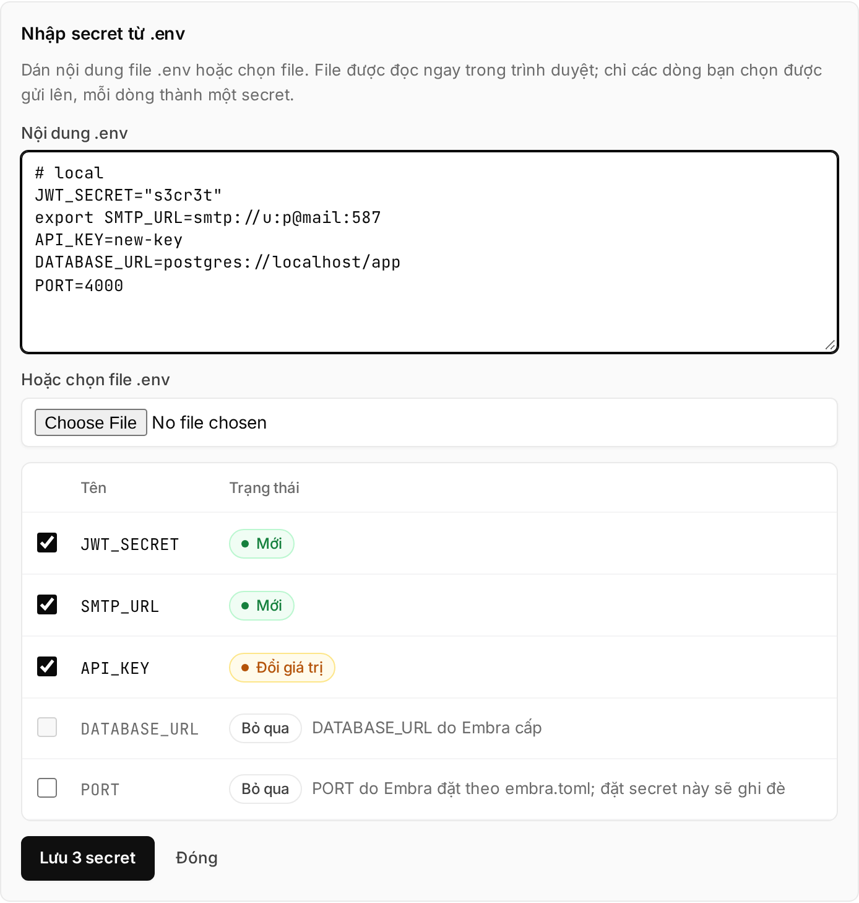

## Đặt env var ở đâu

| Loại biến | Đặt ở đâu | App đọc được lúc chạy? |
|---|---|---|
| Runtime: API key, `TZ`, URL… (kể cả giá trị không bí mật) | **Cài đặt → Secrets** của environment | Có, cùng tên |
| Build-time: `VITE_*`, `NEXT_PUBLIC_*`… | `[build] env` trong `embra.toml` | Không |
| `DATABASE_URL`, `PORT`, `S3_*` | Embra tự đặt | Có |

- `embra.toml` **không** có `[deploy] env`. Field lạ trong `embra.toml` làm build fail ([`REPO_CONFIG_INVALID`](/loi/#repo_config_invalid)).
- Thêm, đổi, thu hồi từng secret: xem [Secret](/huong-dan/secret/).

## Dán cả file .env

1. Mở **Cài đặt → Secrets** của environment → **"Dán .env"**.
2. Dán vào ô **Nội dung .env**, hoặc chọn file ở **"Hoặc chọn file .env"**.
3. Xem bảng: mỗi dòng là **Mới**, **Đổi giá trị**, **Giữ nguyên** hoặc **Bỏ qua**. Bỏ chọn dòng không muốn lưu.
4. Bấm **"Lưu … secret"**.
5. Bấm **"Build lại"** (nếu có) để app nhận giá trị mới.



File được đọc ngay trong browser, chỉ dòng bạn chọn mới gửi lên server.

<details>
<summary>Console đọc file .env thế nào</summary>

- Hiểu comment `#`, prefix `export `, giá trị trong nháy đơn/kép, giá trị nhiều dòng trong nháy.
- Không expand `${BIEN_KHAC}`: lưu nguyên văn.
- Một tên xuất hiện hai lần thì lấy dòng sau.
- Tự bỏ qua: giá trị rỗng, tên sai quy tắc, `DATABASE_URL`, tên bắt đầu bằng `EMBRA_`, và `S3_*` khi environment có bucket của Embra.
- Dòng `PORT` bỏ chọn sẵn, vì Embra đã đặt `PORT` theo `embra.toml`.

</details>

## "Còn thiếu … biến"

Repo có `.env.example` (hoặc `.env.sample`) thì mỗi lần build Embra đọc **tên** biến trong đó. Tên nào chưa có secret sẽ hiện ở **"Còn thiếu … biến"** trên trang Secrets → bấm **"Thêm"** cạnh tên đó.

<details>
<summary>Chi tiết</summary>

- Tìm file ở root directory của app; không có thì tìm ở thư mục con cấp một (ví dụ `backend/.env.example`).
- Chỉ đọc tên, không đọc giá trị. File `.env` thật không bao giờ bị đọc.
- Danh sách lấy từ lần build thành công gần nhất, không tính biến Embra tự đặt.
- File quá 64 KiB thì bỏ qua. Tối đa 200 tên.

</details>

## Biến Embra tự đặt

| Biến | Khi nào | Giá trị |
|---|---|---|
| `PORT` | Luôn, trừ khi bạn tự đặt secret `PORT` | `[deploy] port` trong `embra.toml`, mặc định `3000` |
| `DATABASE_URL` | Có `database = true` | Connection string Postgres của environment. Xem [Database](/huong-dan/database/) |
| `S3_ENDPOINT`, `S3_PUBLIC_ENDPOINT`, `S3_BUCKET`, `S3_REGION`, `S3_ACCESS_KEY_ID`, `S3_SECRET_ACCESS_KEY`, `S3_FORCE_PATH_STYLE` | Environment có bucket của Embra | Xem [Lưu file](/huong-dan/luu-file/) |
| `EMBRA_GIT_SHA` | Build từ một commit GitHub | Commit SHA đầy đủ, 40 ký tự. Không có khi build từ thư mục upload (`embra up`) |

Embra **không** đặt `TZ`: container chạy giờ UTC. Muốn giờ Việt Nam thì đặt secret `TZ` = `Asia/Ho_Chi_Minh`.

Trùng tên thì: secret ghi đè biến cũ; `DATABASE_URL` và `S3_*` của Embra ghi đè secret. Riêng `PORT` thì secret của bạn thắng.

:::caution[Secret `PORT` khác `[deploy] port` làm deploy fail]
Embra health check app trên port ở `[deploy] port`. Secret `PORT` bắt app listen port khác thì health check không đạt, deploy dừng với [`HEALTHCHECK_FAILED`](/loi/#healthcheck_failed). Muốn đổi port thì sửa `[deploy] port`.
:::

## Tên dành cho Embra

- Không đặt được secret tên `DATABASE_URL` hoặc bắt đầu bằng `EMBRA_`. Console báo `… dành cho Embra. Chọn tên khác.`
- `[build] env` không nhận tên bắt đầu bằng `EMBRA_`.
- Tên chỉ gồm chữ in hoa, số, `_`, bắt đầu bằng chữ in hoa, tối đa 64 ký tự (`^[A-Z][A-Z0-9_]{0,63}$`).

## Biến lúc build

```toml
[build]
env = { VITE_API_URL = "https://api.cuahang.vn", NEXT_PUBLIC_SHOP = "Cửa hàng" }
```

- Chỉ có lúc build, không vào app lúc chạy. **Không để giá trị bí mật ở đây**: file nằm trong repo.
- Build **không** nhận secret.
- Repo có `Dockerfile`: mỗi biến được truyền thành build arg, phải khai `ARG` trước khi dùng:

  ```dockerfile
  ARG VITE_API_URL
  RUN npm run build
  ```

- Repo không có `Dockerfile` (Railpack): biến có sẵn lúc build, không cần khai.

## Mỗi environment một bộ biến

- Secret ở production **không** có ở staging hay preview, và ngược lại. Environment nào cũng phải đặt riêng.
- Preview theo PR không mang secret của production.
- `[build] env` giống nhau ở mọi environment vì nằm trong repo.

Xem [Staging, production và duyệt](/huong-dan/staging-production-va-duyet/).

## Khi nào app nhận giá trị mới

- Lưu secret **không** restart app. Giá trị mới chỉ vào app ở **lần build + deploy kế tiếp**: push code, hoặc bấm **"Deploy"** / **"Build lại"** ở trang Tổng quan.
- Plan cho người duyệt thấy **Thêm secret**, **Bỏ secret**, **Đổi secret** (không hiện giá trị).
- Production vẫn chờ Owner hoặc Admin approve như mọi lần deploy.

## Giới hạn

| Giới hạn | Mức | Vượt thì sao |
|---|---|---|
| Mỗi giá trị secret | 64 KiB | Không lưu được: `Giá trị secret tối đa 64 KiB.` |
| Mỗi lần "Dán .env" | 100 secret, tổng 1 MiB | Nút lưu bị khoá. Bỏ chọn bớt, lưu phần còn lại sau |
| File chọn ở "Dán .env" | 2 MiB | Console không đọc file |
| Mỗi giá trị `[build] env` | 4 KiB | Build fail, message nêu tên biến. Xem [`REPO_CONFIG_INVALID`](/loi/#repo_config_invalid) |
| Tổng `[build] env` (tên + giá trị) | 16 KiB | Build fail |

Lưu nhiều secret một lần là all-or-nothing: một dòng lỗi thì không dòng nào được lưu.

## Bằng CLI

- `embra secret set <TEN>`: đọc giá trị từ stdin. `embra secret list`: chỉ hiện tên.
- `embra secret import --env <project>/<env> --file .env`: đặt nhiều secret một lần (all-or-nothing, `--dry-run` chỉ in tên).
- `embra deploy` (image có sẵn) đọc field `env` trong `embra.json`: mỗi giá trị tối đa 4 KiB, tổng 64 KiB. Các biến này được giữ ở các lần build sau từ GitHub; secret cùng tên thắng.

Cài CLI: [Cài đặt CLI](/cli/cai-dat/). Xem [Lệnh CLI](/cli/lenh/).

## Xem thêm

- [Secret](/huong-dan/secret/)
- [Chuẩn bị app](/huong-dan/chuan-bi-app/)
- [Lưu file (bucket S3)](/huong-dan/luu-file/)
- [Staging, production và duyệt](/huong-dan/staging-production-va-duyet/)
