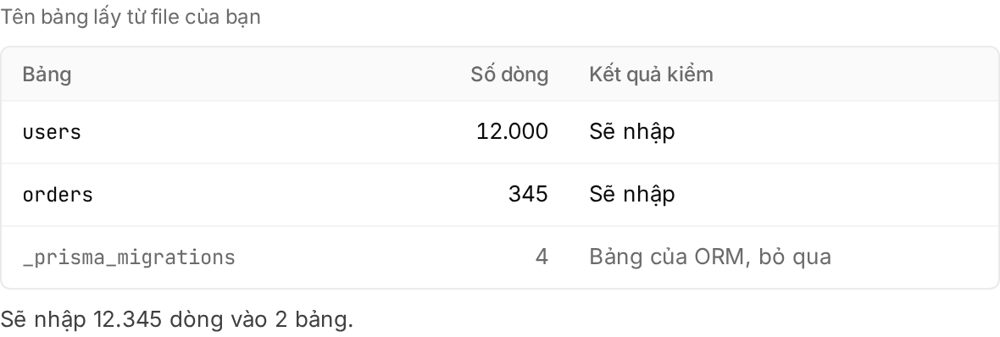

Thứ tự: sửa app → deploy schema → import data → trỏ domain. Xong thì app chạy trên Embra với Postgres riêng chứa data cũ, domain trỏ về Embra.

## Kiểm những gì cần đổi

| Mục | Vì sao | Cách làm |
|---|---|---|
| Port và địa chỉ | App chỉ listen `127.0.0.1` thì Embra không gọi tới được | Listen `0.0.0.0` trên port ở `PORT` (mặc định 3000). [Chuẩn bị app](/huong-dan/chuan-bi-app/) |
| Health check | Bản mới chỉ nhận traffic sau 3 lần `GET` trả 2xx liên tiếp | Đặt `[deploy] health_path` tới path trả 2xx, không redirect. [Health check](/huong-dan/chuan-bi-app/#health-check) |
| Ghi file | Filesystem read-only, chỉ `/tmp` ghi được và mất khi restart | Lưu file user upload vào bucket S3. [Lưu file](/huong-dan/luu-file/) |
| Schema database | Database user của app không đổi được schema | Đưa schema vào `migrations/NNNN_ten.sql`, bỏ lệnh migrate lúc start. [Database và migration](/huong-dan/database-va-migration/) |
| Extension, function, trigger, view | Migration có các lệnh này bị từ chối | App phụ thuộc vào chúng thì chưa chuyển nguyên trạng được |
| Env var | App đọc mỗi secret qua env var cùng tên | Dán file `.env` vào Secrets (xem bên dưới). [Secret](/huong-dan/secret/) |
| Lệnh start, worker, cron | Embra đọc từ `embra.toml` | `[deploy] start`, `[processes.<name>]`, `[cron.<name>]` (giờ UTC). [Chuẩn bị app](/huong-dan/chuan-bi-app/#embratoml) |

## Khác biệt theo nơi cũ

| Nơi cũ | Cần để ý |
|---|---|
| Vercel | `NEXT_PUBLIC_*` nhúng lúc build: đặt trong `[build] env`, không chứa giá trị bí mật. Vercel Postgres nay là Neon: dump bằng connection string direct, không qua pooler |
| Railway, Render, Heroku | Các nơi này cũng đặt `PORT`, nên app thường chạy được ngay. Lệnh start và process chạy nền đổi thành `[deploy] start` và `[processes.<name>]` |
| VPS | Kiểm app có ghi log, ảnh upload hay cache ra đĩa không: chuyển sang `/tmp` hoặc bucket. Lệnh start trong pm2, systemd hay Docker Compose đổi thành `[deploy] start` |

Backup tải về từ nhà cung cấp cũ thường không đúng định dạng Embra nhận. Tạo file bằng `pg_dump` ở bước import data.

## Đưa app và schema lên Embra

1. Thêm `database = true` vào `[deploy]` của `embra.toml`, cùng thư mục `migrations/` tạo đủ bảng của database cũ. Dùng Prisma thì theo [phần Prisma](/huong-dan/database-va-migration/#viết-migration).
2. Tạo app theo [Deploy từ GitHub](/huong-dan/deploy-tu-github/). Embra tạo environment `production` và build lần đầu, chưa có secret.
3. Mở **Cài đặt → Secrets** → **"Dán .env"**, dán `.env` của app cũ → **"Lưu … secret"**. Embra bỏ qua `DATABASE_URL` và tên `EMBRA_*`.
4. Bấm **"Deploy"** (hoặc **"Build lại"**) ở trang Tổng quan để build lại kèm secret. Plan của build đầu bị huỷ, không cần approve.
5. Approve plan mới. Migration tạo bảng trống trong Postgres của Embra.
6. Mở `….onembra.com` của environment, kiểm app chạy được với database trống.

Có staging hoặc preview theo PR thì làm thử ở đó trước (cả bước import), rồi mới làm production.

## Nhập dữ liệu Postgres

Embra chỉ import **row data** vào bảng đã có sẵn và **đang trống**. Schema luôn đi qua migration.

:::caution[Import trước khi app production nhận traffic]
Chỉ cần một bảng đích có data (ví dụ một người đăng ký thử) là lần import bị từ chối. Data ghi ở app cũ sau lúc dump cũng không import bổ sung được vào bảng đã có data.
:::

1. Import thật vào production thì dừng ghi ở app cũ trước (bật trang bảo trì hoặc chế độ read-only). Data ghi sau lúc dump không có trong file.
2. Chạy trên máy đọc được database cũ, thay `<DATABASE_URL>` bằng connection string của nó:

   ```sh
   pg_dump --data-only --no-owner --no-acl -d "<DATABASE_URL>" | gzip > data.sql.gz
   ```

   Bảng nào đã có data trên Embra (ví dụ bảng migration đã seed) thì bỏ data của nó khỏi file:

   ```sh
   pg_dump --data-only --no-owner --no-acl --exclude-table-data=public.admin_users -d "<DATABASE_URL>" | gzip > data.sql.gz
   ```

3. Trên console, trang **Tổng quan** → mục **Những gì đang chạy** → bấm dòng **Database** → **"Nhập dữ liệu…"**.
4. Chọn file ở **"File dump (.sql hoặc .sql.gz)"** → **"Tải lên và kiểm"**. Embra báo số dòng và số bảng trong file.
5. Bấm **"Kiểm với database"**. Embra so file với database, chưa ghi gì. Mọi bảng hiện **"Sẽ nhập"** hoặc **"Bảng của ORM, bỏ qua"** là đạt.

   

6. Staging và preview: Embra import ngay. Production cần Owner hoặc Admin approve trong vòng 1 giờ, quá hạn thì lần import bị huỷ và phải upload lại:
   - Owner, Admin: gõ tên environment rồi bấm **"Duyệt và nhập dữ liệu"** ngay trong hộp thoại.
   - Developer: bấm **"Mở trang duyệt"**, gửi trang đó cho Owner hoặc Admin.
7. Chờ **"Đã nhập … dòng vào … bảng."**, rồi mở app kiểm vài record bạn biết trước (mã đơn, tổng tiền), không chỉ đếm số dòng.

Cả lần import chạy trong một transaction: lỗi ở đâu thì database không đổi gì. Trong lúc import, deploy của environment phải chờ.

| Yêu cầu với file | Chi tiết |
|---|---|
| Định dạng | Bắt buộc `--data-only`, SQL thuần (gzip được). File có `CREATE` hay `ALTER`, file tạo bằng `--inserts` hoặc custom format (`-Fc`) đều bị từ chối |
| Schema, encoding | Chỉ bảng trong schema `public`, UTF8 |
| Cỡ file | Kể cả sau giải nén, không vượt dung lượng database của gói. File đã upload mà không dùng bị xoá sau 24 giờ |
| Bảng migration của ORM | `_prisma_migrations`, `knex_migrations`, `schema_migrations`, `django_migrations`… được bỏ qua nếu database Embra không có |
| Ai thấy nút **"Nhập dữ liệu…"** | Owner, Admin, Developer |

## Sửa khi kiểm không đạt

| Embra báo | Cách sửa |
|---|---|
| **"Database không có bảng này"**, **"Thiếu cột: …"**, **"Database không có sequence …"** | Thêm bảng hoặc cột bằng migration rồi deploy, hoặc bỏ data bảng đó bằng `--exclude-table-data`. Tạo file mới, upload lại |
| **"Bảng đã có dữ liệu"** | Đã import file này rồi thì data đã vào. Chưa thì bỏ data bảng đó bằng `--exclude-table-data` rồi upload lại |
| File bị từ chối ngay khi upload | Chạy lại `pg_dump` đúng lệnh ở trên, có `--data-only`. Database cũ không dùng UTF8 thì thêm `--encoding=UTF8` |

Embra chỉ import dump của Postgres; MySQL hay database khác chưa import được. Lỗi khác: email hello@embra.cloud kèm `operation_id` của lần import, tên workspace, environment và thời điểm.

## Trỏ domain về Embra

1. Hạ TTL record domain ở nhà cung cấp DNS xuống khoảng 300 giây, trước 1–2 ngày.
2. Mở **Cài đặt → Domain** của environment production, nhập domain → **"Thêm domain"**.
3. Thêm record TXT Embra hiện. Record này không ảnh hưởng app cũ.
4. Import data xong thì đổi record CNAME (hoặc A với root domain) sang giá trị Embra hiện.
5. Bấm **"Kiểm tra"**. Embra cần cả TXT và CNAME (hoặc A) đúng mới verify; HTTPS được cấp ở request đầu tiên.
6. Giữ app và database cũ ở read-only vài ngày, phòng khi phát hiện thiếu data.

Domain chưa verify chỉ được giữ 7 ngày, nên đừng thêm domain quá sớm. Chi tiết và lưu ý Cloudflare: [Domain riêng](/huong-dan/domain-rieng/).

## Xem thêm

- [Chuẩn bị app](/huong-dan/chuan-bi-app/)
- [Database và migration](/huong-dan/database-va-migration/)
- [Secret](/huong-dan/secret/)
- [Lưu file (bucket S3)](/huong-dan/luu-file/)
- [Domain riêng](/huong-dan/domain-rieng/)
- [Mã lỗi](/loi/)
