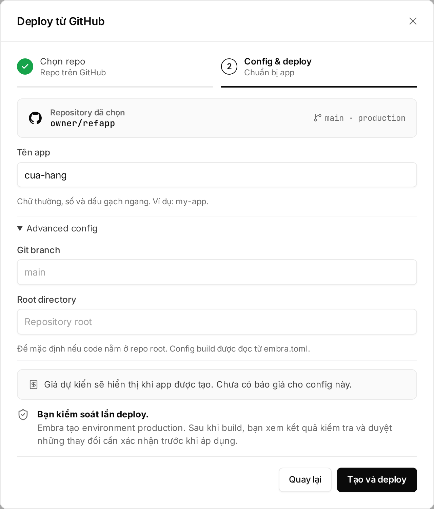
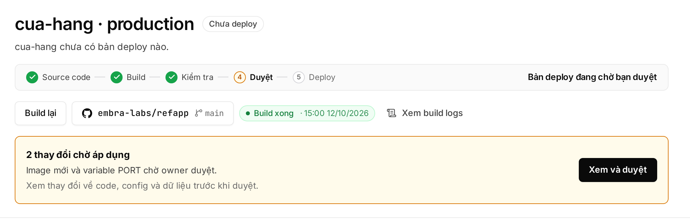

## Tạo app lần đầu

1. Bấm **"＋ Tạo mới"** → **"Deploy từ GitHub"**.
2. Bấm **"Kết nối GitHub ↗"**, cài Embra GitHub App cho account hoặc organization chứa repo. Bạn chọn repo nào Embra được thấy.
3. Chọn repo → **"Tiếp tục"**.
4. Đặt **Tên app**: chữ thường, số, dấu `-`, bắt đầu bằng chữ cái. Monorepo hoặc không dùng branch mặc định thì mở **"Advanced config"** để chọn **Git branch** và **Root directory**.
5. Bấm **"Tạo và deploy"**. Embra tạo environment `production`, connect repo + branch rồi build.



Không thấy repo? Bấm **"Không thấy repo? Cập nhật quyền GitHub ↗"** rồi **"Tải lại"**. Chỉ người login bằng GitHub mới connect được repo, và chỉ repo mà account GitHub đó đọc được.

## Duyệt production

Build xong, Embra tạo **plan**: tóm tắt thay đổi (image mới, secret thêm/bớt/đổi, migration đang chờ).



1. Thanh plan hiện "… thay đổi chờ áp dụng" → bấm **"Xem và duyệt"**.
2. Xem thay đổi code, config, data.
3. Gõ tên environment → **"Duyệt và deploy"**. Migration có thể làm mất data thì gõ thêm `CONFIRM_MIGRATION`.

| Quy tắc | Chi tiết |
|---|---|
| Ai approve được | Chỉ Owner, Admin. Production luôn chờ approve, kể cả không có migration. Developer và AI agent không approve được |
| Cần người thật | Session web login trong vòng 12 giờ. Xem [Việc cần người thật](/workspace/phan-quyen/#việc-cần-người-thật) |
| Hết hạn | Plan chờ quá 24 giờ thì hết hạn |
| Có build mới | Plan cũ bị huỷ, nên không bao giờ approve nhầm bản cũ |

Approve xong, app chạy ở:

```
https://<tên-app>-production-<mã workspace>.onembra.com
```

## Auto build khi push

- Push lên branch đã connect → Embra build commit đó. Push branch khác hoặc tạo tag thì không build.
- Build mới huỷ build cũ đang chạy của cùng environment.
- Muốn build lại commit mới nhất mà không push: bấm **"Deploy"** ở trang Tổng quan (nút thành **"Build lại"** khi đang có plan chờ duyệt).
- Production chờ approve sau mỗi build. Staging và preview tự deploy, trừ khi migration đổi data.

## Preview theo pull request

Gói có preview (xem [bảng giá](https://embra.cloud/bang-gia/)): mỗi PR vào branch production có environment `pr<số>` riêng.

| Mục | Preview |
|---|---|
| URL | `pr<số>-<địa chỉ production>` |
| Database | Mới, rỗng, không copy data production. Nạp data mẫu bằng `[preview] seed` |
| Secret, bucket, domain | Không mang từ production sang |
| Tự xoá | Khi đóng PR, hoặc sau 72 giờ không có push mới |
| PR từ fork | Bỏ qua |

## Xem log

- **Build log:** bấm **"Xem build logs"** ở trang Tổng quan. Tra mã lỗi ở [Mã lỗi và cách sửa](/loi/).
- **App log:** mục **"Logs"**. Container chạy giờ UTC; muốn giờ Việt Nam thì đặt secret `TZ` = `Asia/Ho_Chi_Minh`.
- Log và metrics giữ bao lâu tuỳ gói (dùng thử: 1 ngày).

## Rollback

Bấm **Quay về bản trước** ở dải **Lịch sử & khôi phục** trên trang environment. Web luôn lùi đúng một bản.

- Không cần approve, vì rollback chỉ chạy lại code đã được approve.
- Embra từ chối nếu migration đã chạy tiếp sau bản đó.

Chi tiết: [Rollback và khôi phục backup](/huong-dan/rollback-va-khoi-phuc/). Cần hỗ trợ gấp: hello@embra.cloud.
