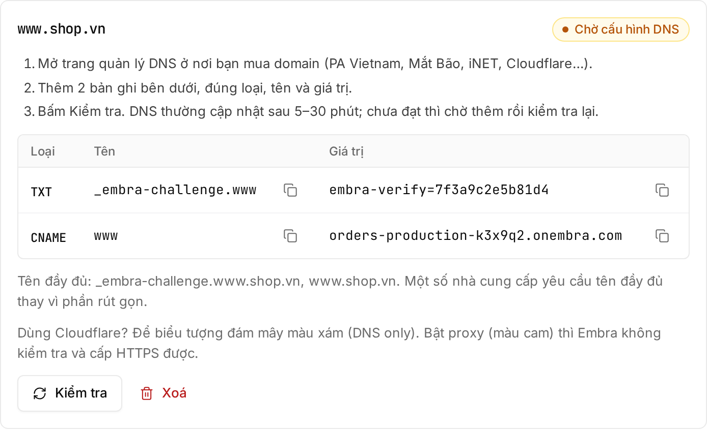

| Gói | Số domain |
|---|---|
| Dùng thử | Không có |
| Start | 3 |
| Build | 5 |
| Grow | 10 |

Đếm chung mọi environment của workspace. **Mỗi tên tính là một domain**: `shop.vn` và `www.shop.vn` là hai domain.

## Các bước

1. Mở **Cài đặt → Domain**, nhập domain (ví dụ `www.shop.vn` hoặc `shop.vn`) → **"Thêm domain"**.
2. Thêm các record Embra hiện ở DNS provider:

   | Loại | Tên | Giá trị |
   |---|---|---|
   | TXT | `_embra-challenge.www.shop.vn` | `embra-verify=…` (Embra hiện giá trị) |
   | CNAME | `www` | địa chỉ app, dạng `<app>-production-<mã>.onembra.com` |

   **Root domain** (`shop.vn`, không có `www`): dùng record **A** tới IP Embra hiện trên màn hình thay cho CNAME.

   
3. Đợi DNS cập nhật (thường 5–30 phút) → bấm **"Kiểm tra"**. Chưa đạt thì chờ thêm rồi kiểm tra lại.
4. Verify xong, HTTPS được cấp tự động ở request đầu tiên, thường dưới 1 phút.

:::caution[Dùng Cloudflare?]
Để icon đám mây màu **xám (DNS only)** cho các record trên. Bật proxy (đám mây cam) thì Embra không verify và không cấp HTTPS được.
:::

## Giữ bản ghi TXT

**Đừng xoá TXT record sau khi verify.** Embra kiểm lại mỗi 24 giờ. Mất record 3 lần liên tiếp thì Embra ngừng phục vụ domain đó. Lỗi mạng tạm thời không bị tính.

## Lưu ý

- Muốn cả `shop.vn` và `www.shop.vn` thì thêm cả hai. Embra chưa tự redirect giữa hai tên; bạn đặt redirect ở nhà cung cấp domain.
- Chưa hỗ trợ wildcard domain (`*.shop.vn`) hay upload certificate của bạn.
- Một domain chỉ gắn được vào một app trên Embra.
- Domain chưa verify được giữ 7 ngày rồi tự bỏ.
- Mỗi domain kiểm tra tối đa 1 lần mỗi 30 giây.
