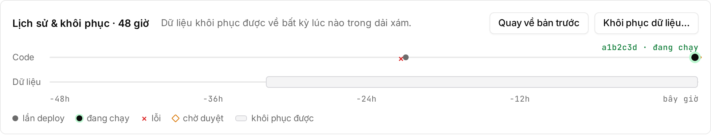
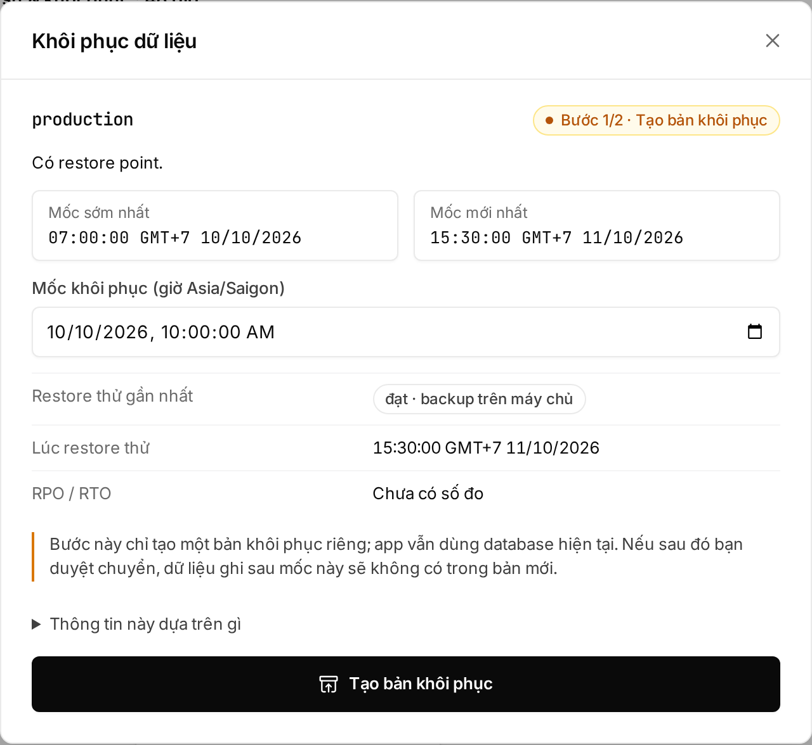

## Nên dùng cách nào?

| Bạn gặp | Dùng | Đụng tới data? | Cần approve? |
|---|---|---|---|
| Bản mới lỗi, data vẫn đúng | Rollback | Không | Không |
| Data bị xoá hoặc ghi sai | Restore backup | Có: data ghi sau mốc chọn bị mất | Owner hoặc Admin |
| Mang app + data đi nơi khác | Export | Không | Chỉ Owner, Admin tạo được |

## Rollback về bản trước

Rollback chạy lại bản deploy **ngay trước** bản đang chạy: khởi động, health check, chuyển traffic. Data trong database không bị tua lại.

- Owner, Admin, Developer đều rollback được.
- Không cần approve, kể cả production, vì bản đó đã từng được approve và chạy.

1. Mở environment, tìm dải **"Lịch sử & khôi phục"** ở đầu trang.
2. Bấm **"Quay về bản trước"**. Nút chỉ hiện khi đã có ít nhất 2 lần deploy thành công, và bị khoá khi đang có operation khác chạy.
3. Production: gõ tên environment rồi bấm **"Quay về bản trước"** trong hộp thoại.
4. Embra mở trang chi tiết operation. Bản cũ nhận traffic khi trạng thái là **"Deploy thành công"**.



Web chỉ lùi đúng một bản, không chọn được bản cũ hơn.

### Bấm rollback lần thứ hai

Rollback tạo một bản mới, và "bản trước" của nó chính là bản lỗi bạn vừa rời. Bấm **"Quay về bản trước"** lần nữa sẽ **đưa bản lỗi trở lại**, không lùi thêm. Muốn sửa tiếp thì push commit mới.

### Khi Embra từ chối rollback

Embra kiểm tra trước khi làm, nên bị từ chối thì app đang chạy không bị đụng tới.

| Lý do | Mã lỗi | Cách xử lý |
|---|---|---|
| Có migration chạy sau bản đó | [`ROLLBACK_INCOMPATIBLE`](/loi/#rollback_incompatible) | Sửa bằng commit mới chạy được với schema hiện tại |
| Secret bản đó dùng đã bị thu hồi | [`SECRET_REVOKED`](/loi/#secret_revoked) | Deploy bản mới với secret hiện tại |
| Đang có operation khác chưa xong | [`OPERATION_IN_PROGRESS`](/loi/#operation_in_progress) | Chờ operation đó xong |
| Environment bị chặn sau sự cố | [`ENVIRONMENT_BLOCKED`](/loi/#environment_blocked) | Liên hệ đội Embra |
| Bản đang chạy là bản đầu tiên, hoặc environment đang tạm dừng | [`INVALID_INPUT`](/loi/#invalid_input) | Không có bản trước để quay về / bật lại environment trước |

Rollback chỉ trả code, không trả schema. Code cũ có thể không chạy trên schema mới, nên Embra chặn khi migration đã chạy tiếp.

## Backup của database

Environment nào có Postgres cũng được backup tự động, không cần bật.

| Mục | Chi tiết |
|---|---|
| Liên tục | Mọi thay đổi được ghi lại (WAL), đẩy vào backup ít nhất mỗi phút |
| Bản đầy đủ | Mỗi 7 ngày, giữ 2 bản gần nhất |
| Khoảng restore được | Từ bản đầy đủ cũ nhất còn giữ tới khoảng 1–2 phút trước. Database mới tạo: tính từ bản đầy đủ đầu tiên. Database chạy hơn 2 tuần: dài 7 tới 14 ngày, tuỳ lúc bản đầy đủ mới nhất chạy |
| Nơi lưu | Trên server, ổ đĩa riêng tách khỏi ổ chứa database. Chưa có bản copy ra ngoài server |
| Restore thử | Mỗi 7 ngày Embra tự dựng lại database từ backup để chắc backup dùng được. Kết quả hiện ở mục **Backup** trong dải trạng thái đầu trang environment |

| Console hiện | Nghĩa |
|---|---|
| **"Restore thử đạt"** | Lần restore thử gần nhất thành công |
| **"Chưa restore thử"** | Database mới, chưa tới lần restore thử đầu tiên |
| **"Restore thử thiếu dữ liệu"** | Backup thiếu một đoạn ([`BACKUP_WAL_GAP`](/loi/#backup_wal_gap)) |
| **"Restore thử thất bại"** | Không dựng lại được từ backup. Đừng dựa vào khoảng restore, email hello@embra.cloud |

Backup tạm ngừng khi database đang dừng hoặc environment bị chặn sau sự cố.

## Khôi phục database về một mốc thời gian

Restore có hai bước: xem trước rồi mới chuyển app.

```
Bước 1: Tạo bản khôi phục        Bước 2: Chuyển sang bản này
(Owner, Admin, Developer)        (Owner hoặc Admin, trong 2 giờ)
database mới chạy song song  →   app dùng database mới
app vẫn dùng database cũ         database cũ giữ 72 giờ, chỉ đọc
```

**Bước 1. Tạo bản khôi phục**

1. Trên dải **"Lịch sử & khôi phục"**, bấm **"Khôi phục dữ liệu…"** (hoặc **"Xem mốc khôi phục"** ở trang Tổng quan).
2. Xem khoảng restore được, từ **"Mốc sớm nhất"** tới **"Mốc mới nhất"**.
3. Nhập **Mốc khôi phục** trong khoảng đó, theo giờ máy của bạn.
4. Bấm **"Tạo bản khôi phục"**. Embra dựng database mới từ mốc đó; database đang chạy chưa bị đụng tới.



**Bước 2. Chuyển sang bản khôi phục** (Owner hoặc Admin)

1. Bản khôi phục sẵn sàng thì trang operation hiện **"Chuyển sang bản khôi phục"**, kèm số dòng ước tính của từng bảng.
2. Gõ tên environment để xác nhận.
3. Bấm **"Chuyển sang bản này"**, hoặc **"Huỷ bản khôi phục"** nếu không dùng.
4. Embra chuyển app sang database mới, không dừng app.

Người approve phải login web trong vòng 12 giờ. Quá 2 giờ không approve thì bản khôi phục bị huỷ và dọn đi; làm lại từ bước 1.

:::caution[Data ghi sau mốc chọn sẽ mất]
Sau khi chuyển, mọi thứ app ghi sau mốc khôi phục không có trong database mới. Trong lúc chuyển, database cũ thành read-only nên app có thể báo lỗi ghi vài giây.
:::

### Quay lại database cũ sau khi khôi phục

Database cũ được giữ **72 giờ** sau khi chuyển (dùng thử: 24 giờ). Trong thời gian đó, rollback về bản deploy chạy trước lúc restore sẽ đưa app về database cũ.

- Chỉ Owner hoặc Admin, và phải là người thật (session web trong 12 giờ).
- Hết thời gian giữ thì database cũ bị xoá: rollback báo [`ROLLBACK_DB_GONE`](/loi/#rollback_db_gone).
- Đã có migration chạy trên database mới sau lúc chuyển: rollback bị chặn với [`ROLLBACK_INCOMPATIBLE`](/loi/#rollback_incompatible).

:::danger[Mất data ghi trên database mới]
Quay về database cũ là bỏ mọi thứ app đã ghi vào database mới kể từ lúc chuyển. Không lấy lại được phần đó.
:::

### Khi không khôi phục được

| Bạn thấy | Mã lỗi | Cách xử lý |
|---|---|---|
| Mốc nằm ngoài khoảng, hoặc chưa có backup | [`RESTORE_POINT_UNAVAILABLE`](/loi/#restore_point_unavailable) | Chọn mốc giữa **"Mốc sớm nhất"** và **"Mốc mới nhất"** |
| Có migration chạy sau mốc đã chọn | [`MIGRATION_AFTER_RESTORE_POINT`](/loi/#migration_after_restore_point) | Chọn mốc sau migration đó |
| Backup không tới được đúng mốc | [`RESTORE_SHORT`](/loi/#restore_short) | Email hello@embra.cloud |
| Operation hiện **"Cần đội Embra hỗ trợ"** | [`RECOVERY_REQUIRED`](/loi/#recovery_required) | Đừng xoá environment; email kèm mã operation |

Environment đang tạm dừng hoặc database đang dừng thì không restore được; bật lại trước.

## Export dữ liệu

Export tạo một bundle gồm image, manifest, file `pg_dump` và danh sách object của bucket. Bundle không chứa giá trị secret.

1. Mở **"Cài đặt"** → **"Dữ liệu"** → **"Export"**.
2. Cần cả file trong bucket thì tick **"Kèm nội dung object của bucket"**.
3. Bấm **"Tạo export"**.
4. Export xong, bấm **"Tải bundle"**.

| Mục | Chi tiết |
|---|---|
| Ai làm được | Chỉ Owner hoặc Admin. Export production cần session web login trong 12 giờ |
| Tự xoá | Sau 24 giờ |
| Vượt giới hạn dung lượng | [`QUOTA_EXCEEDED`](/loi/#quota_exceeded) |

## Dùng CLI

Lệnh tương ứng (xem lưu ý về CLI login ở [Danh sách lệnh](/cli/lenh/)):

```sh
embra rollback --env <project>/<env>
embra db restore-points --env <project>/<env>
embra db restore --env <project>/<env> --to 2026-11-01T08:30:00+07:00
embra export --env <project>/<env>
```

`embra db restore` chỉ tạo bản khôi phục. Bước chuyển vẫn cần Owner hoặc Admin approve.

## Xem thêm

- [Database và migration](/huong-dan/database-va-migration/)
- [Xem log và theo dõi app](/huong-dan/log-va-theo-doi/)
- [Rollback và khôi phục: mã lỗi](/loi/#rollback-và-khôi-phục)
- [Thành viên và phân quyền](/workspace/phan-quyen/)
