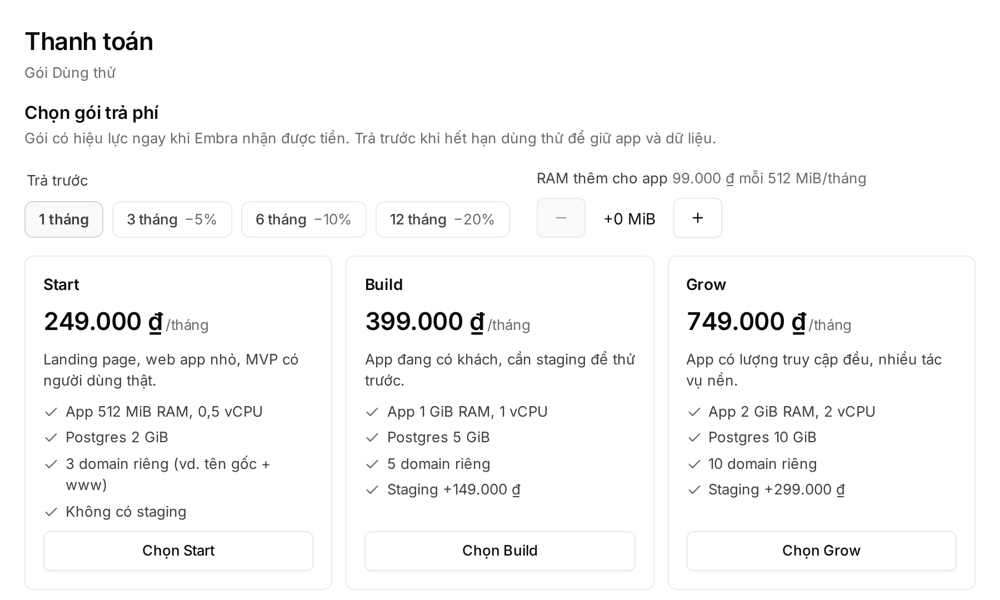

## Đăng nhập

Vào console, bấm **"Đăng nhập bằng GitHub"**. Lần đầu login, Embra tạo cho bạn một **workspace dùng thử** mang tên account GitHub, bạn là Owner.

| Quy tắc | Chi tiết |
|---|---|
| Tuổi account GitHub | Ít nhất **30 ngày**. Account mới hơn: gửi username GitHub tới hello@embra.cloud để được mở riêng |
| Lượt dùng thử | Số lượt dùng thử mới mỗi ngày có giới hạn |
| **"Đăng nhập bằng Google"** | Chỉ cho người được mời vào workspace có sẵn. Google không tạo workspace dùng thử |
| Email GitHub đang có lời mời | Bạn vào thẳng workspace đó và **không** nhận gói dùng thử |

Gặp **"Chưa vào được Embra"**? Có ba khả năng:

- Login Google bằng email chưa được mời → nhờ Owner mời đúng email đó.
- Account GitHub chưa đủ 30 ngày.
- Hết lượt dùng thử hôm nay → thử lại hôm sau.

Cần giúp: email hello@embra.cloud.

## Gói dùng thử

| Mục | Dùng thử |
|---|---|
| Thời hạn | 7 ngày |
| Số lần | **Một lần mỗi account** |
| App | 1 project, 1 environment (production) |
| Postgres | 1 |
| Domain riêng, preview theo PR, cron | Không có |

Banner **"Dùng thử · xoá sau N ngày"** cho biết thời gian còn lại.

:::caution[Hết 7 ngày là xoá]
Hết hạn thì mọi thao tác bị chặn, kể cả xem. Sau đó **toàn bộ workspace bị xoá**: app, database và backup. Chưa chọn gói thì không có thời gian ân hạn. Đã chọn gói trước khi hết hạn thì Embra giữ workspace thêm **72 giờ** chờ tiền về; Owner vẫn thấy mã chuyển khoản và QR trên màn hình hết hạn.

Muốn giữ app thì **chọn gói và chuyển khoản trước khi hết hạn**. Embra gửi cảnh báo 24 giờ trước. Chỉ cần lấy data thì export ở **Cài đặt → Dữ liệu → Export** trước thời hạn.
:::

## Sau khi workspace bị xoá

Mọi workspace của bạn đã bị xoá (bạn tự xoá, hoặc dùng thử hết hạn và bị dọn) thì lần login sau Embra mở một workspace **"Chưa có gói"**, bạn là Owner. Không có dùng thử lần hai.

- Workspace "Chưa có gói" không tạo được project, environment hay fork: lỗi [`PLAN_REQUIRED`](/loi/#plan_required).
- Chọn gói và chuyển khoản như bên dưới. Tiền về thì gói có hiệu lực, tạo project được ngay.
- Data của workspace đã xoá không khôi phục được.

## Chọn gói và thanh toán

Chỉ **Owner** chọn gói được, và chỉ trên browser.

1. Bấm **"Chọn gói"** trên banner dùng thử, hoặc mở menu tài khoản → **"Thanh toán"**.
2. Ở **"Trả trước"**, chọn 1, 3, 6 hoặc 12 tháng (giảm 0/5/10/20%). Cần thì thêm **"RAM thêm cho app"**.
3. Bấm **"Chọn Start"**, **"Chọn Build"** hoặc **"Chọn Grow"**. Giá và giới hạn từng gói: [embra.cloud/bang-gia](https://embra.cloud/bang-gia/).
4. Có thể ghi tên người hoặc công ty trên hoá đơn. Embra chưa có pháp nhân nên chưa xuất hoá đơn VAT.
5. Bấm **"Xác nhận và lấy mã VietQR"**.
6. Quét mã bằng app ngân hàng, hoặc chuyển khoản tay đúng **số tiền** và **nội dung chuyển khoản** hiển thị (có nút **"Chép"**).

- Gói có hiệu lực ngay khi Embra nhận được tiền. Từ lúc đó workspace không còn hạn dùng thử.
- Chưa tự động xác nhận thì đội Embra xác nhận tay trong giờ làm việc.
- Trạng thái hoá đơn ở mục **"Hoá đơn"**: Chưa thanh toán, Đang đối soát, Đã thanh toán hoặc Quá hạn.
- Admin xem được billing nhưng không chọn gói hay thanh toán được. Xem [Thành viên và phân quyền](/workspace/phan-quyen/).

## Đổi gói khi đã trả phí

Mở **"Thanh toán"** và chọn gói khác. Console ghi rõ số tiền hoặc ngày đổi trước khi bạn xác nhận.

**Nâng gói** (giá tháng cao hơn):

- Trả phần chênh lệch theo ngày, từ hôm nay tới hết kỳ (đang trả trước thì tới hết kỳ trả trước, ở mức giảm của kỳ), làm tròn xuống 1.000đ.
- **Gói chỉ đổi khi tiền về.** Số dư đủ thì gói đổi ngay.
- Mã thanh toán dùng được tới hết kỳ hiện tại. Tiền về sau đó được ghi vào số dư và gói không đổi; khi đó chọn lại gói để nhận số tiền mới.

**Hạ gói** (giá tháng thấp hơn):

- Gói hiện tại giữ tới hết kỳ, gói mới áp dụng từ đầu kỳ kế. Đổi ý thì bấm **"Giữ gói …"** trước ngày đó.
- Workspace phải vừa gói mới về domain riêng, staging, preview, dung lượng và số database. Cỡ app được tự giảm, áp dụng ở lần deploy sau.

Còn hoá đơn quá hạn thì chưa đổi gói được. Quy định đầy đủ: [Điều khoản, mục 4](https://embra.cloud/terms/#goi).
